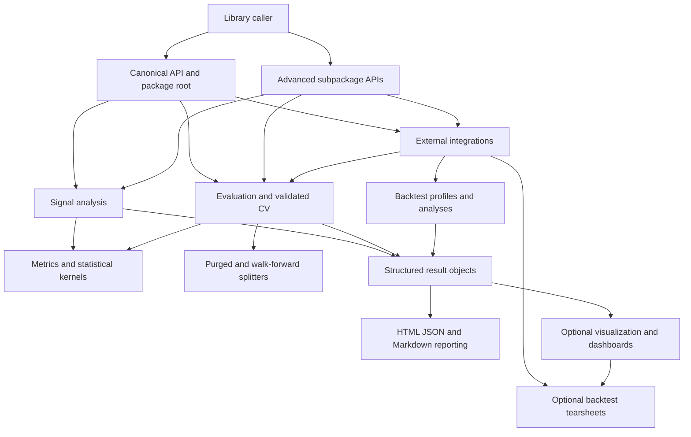

# System Architecture and Public Surfaces

`ml4t-diagnostic` is organized around analytical workflows rather than a single service runtime. Callers submit factor panels, model data, or backtest artifacts; domain workflows validate and analyze them using shared splitters and metric kernels; results then remain machine-readable or flow into optional visualization and reporting layers.

The most important architectural rule is **compute first, present later**. Signal analysis and evaluation own statistical meaning. Result objects carry the output. Integrations translate external data into those native workflows. Visualization and report generators consume results rather than redefining calculations.

## Public API tiers

There are three deliberately different import surfaces.

### 1. Canonical stable integration API

Use `ml4t.diagnostic.api` when application code needs the narrowest stable surface. Its explicit `__all__` collects the main validated-CV workflow, feature/trade/portfolio analyses, signal analysis, primary splitters, causality checks, and selected metric functions. The evaluation package itself directs users to this module for the stable integration surface.

```python
from ml4t.diagnostic.api import (
    ValidatedCrossValidation,
    analyze_signal,
    CombinatorialCV,
)
```

This is the preferred boundary for long-lived consumers because it avoids depending on the broader organization of individual subpackages.

### 2. Stable top-level conveniences

`ml4t.diagnostic` also declares its public API through an explicit `__all__`. It exposes the highest-level workflows (`Evaluator`, `ValidatedCrossValidation`, `FeatureSelector`, `analyze_signal`, and `analyze_prepared_signal`), result and causality types, primary configuration models, data-quality contracts, and selected barrier plots. It additionally exports submodule objects such as `evaluation`, `signal`, `splitters`, and `integration` as navigation points for advanced use.

The root surface is broader than `ml4t.diagnostic.api`; the two lists should not be assumed to be identical. In particular, the canonical API includes advanced analyses and metric functions that are not all copied to the package root, while the root includes convenience configuration and integration-contract types.

### 3. Advanced subpackage APIs

Each owned domain publishes its own explicit `__all__`:

- `ml4t.diagnostic.signal` exposes the end-to-end signal workflows plus preparation, IC, quantile, portfolio, event, and turnover building blocks.
- `ml4t.diagnostic.evaluation` exposes the general evaluator, validated CV, analysis classes, uncertainty routines, registries, and factor attribution.
- `ml4t.diagnostic.integration` exposes external contracts and backtest bridge entry points.
- `ml4t.diagnostic.results` exposes Pydantic result schemas.
- `ml4t.diagnostic.reporting` exposes the renderer factory and concrete HTML, JSON, and Markdown generators.
- `ml4t.diagnostic.visualization` exposes Plotly plots, dashboards, report composition, and PDF export.

These are public within their domain, but are intentionally larger and more specialized than `ml4t.diagnostic.api`. Import a low-level implementation module directly only when the package-level domain export does not provide the required extension point.

## Domain map and dependency direction



*The arrows show orchestration and dependency direction: entry points call analytical domains, domains use kernels and splitters, and presentation consumes completed analytical output.*

This direction keeps rendering optional and prevents core calculations from depending on a UI. Two presentation routes coexist: the generic `reporting` factory renders `BaseResult` schemas, while backtest integration composes richer profiles and tearsheets through the visualization stack.

## Runtime domains

### Signal analysis owns factor-panel semantics

`analyze_signal()` is the factor-and-price entry point. It converts supported frames to Polars, computes forward returns, optionally filters cross-sectional outliers, assigns quantiles, and then calculates IC, quantile returns, spread, monotonicity, and optional turnover/autocorrelation into a `SignalResult`.

`analyze_prepared_signal()` is a different ownership boundary: it accepts already-computed return columns and buckets. It validates the prepared panel and preserves the supplied bucket assignments rather than recomputing them. It rejects conflicting horizon selectors, duplicate keys, missing or non-finite values, and invalid buckets before analysis. This route is important when an upstream data pipeline owns sampling and bucket formation. See [Signal Analysis](../workflows/signal-analysis.md) for the operational workflow.

### Evaluation owns model and strategy validation

The general `Evaluator` composes splitters, metric registries, and statistical-test registries across screening, statistical-significance, and rigorous-validation tiers. `MetricRegistry` and `StatTestRegistry` are extension boundaries for named calculations.

`ValidatedCrossValidation` is the focused one-call workflow. It constructs a `CombinatorialCV` splitter from configuration, validates an optional timestamp vector, fits and predicts per fold, converts predictions to strategy returns (or delegates to `returns_fn`), computes fold Sharpes, and applies a Deflated Sharpe Ratio calculation to the observed fold distribution. The returned `ValidationResult` includes fold outputs, aggregate Sharpe statistics, significance, the expected null maximum, and a human-readable interpretation.

The optional `times` vector verifies length, datetime validity, absence of missing values, and non-decreasing order. It does **not** turn sample-based `label_horizon` or `embargo_pct` into elapsed-time purging; callers needing elapsed-time behavior must configure `CombinatorialCV` directly. See [Validated Cross-Validation](../workflows/validated-cross-validation.md).

### Integrations translate; they do not become the analytical core

The integration package defines typed contracts for `ml4t-data`, `ml4t-engineer`, and `ml4t-backtest`. Backtest entry points include metric computation, profile construction, portfolio-analysis conversion, and tearsheet generation from either a `BacktestResult` or persisted run artifacts.

The backtest bridge is loaded through a cached dynamic import only when one of those functions is called. Importing `ml4t.diagnostic.integration` therefore does not require or eagerly import `ml4t-backtest`. If that package is unavailable, bridge use raises an actionable error naming `pip install 'ml4t-diagnostic[backtest]'`; unrelated internal import failures are re-raised rather than being mislabeled. The detailed conversion and report flow is documented in [Backtest to Tearsheet](../integrations/backtest-to-tearsheet.md).

### Structured results are the interchange boundary

`ml4t.diagnostic.results.BaseResult` is the common Pydantic contract for schema-backed analytical output. It forbids unknown fields, validates assignment, records creation metadata, and supplies dictionary and JSON serialization. Concrete schemas implement human summaries and one or more Polars DataFrame views discoverable through `list_available_dataframes()`.

Not every historical workflow result derives from `BaseResult`: for example, `EvaluationResult`, `SignalResult`, and validated-CV dataclasses provide workflow-specific interfaces. Consumers should therefore rely on the concrete result type promised by their chosen entry point rather than assuming one universal result class. The broader time and result invariants are covered in [Contracts, Time, and Results](../concepts/contracts-time-and-results.md).

### Rendering is downstream and extensible

`ReportFactory` maps `ReportFormat` values to `ReportGenerator` implementations. Importing `ml4t.diagnostic.reporting` registers HTML, JSON, and Markdown renderers; `ReportFactory.render()` selects a generator, and `ReportGenerator.save()` creates parent directories before writing UTF-8 output. New generic formats extend this registry by implementing `render()` and registering the class.

Visualization is a separate, Plotly-oriented surface. Its plots accept completed analysis data and return figures; its higher layers compose HTML/PDF reports and dashboards. Core evaluation methods load visualization functions on demand and produce installation guidance when the `viz` extras are absent.

## Optional-import behavior

Optionality is part of the runtime contract, not merely packaging metadata:

- Core scientific, dataframe, configuration, and calendar dependencies are installed by default.
- `viz` adds Plotly, Matplotlib, Seaborn, Kaleido, PDF support, and renderer process management.
- `dashboard` adds Streamlit; `ml`, `perf`, `data`/`factors`, and `backtest` add specialized model, acceleration, data, and backtest capabilities.
- The package root catches visualization import failure and keeps the four barrier plot names present as `None`. Code that needs a plot should import from `ml4t.diagnostic.visualization` after installing `ml4t-diagnostic[viz]`, rather than treating a root-level `None` as a callable.
- `ml4t.diagnostic.evaluation` similarly tolerates a missing visualization/report stack and lazy-loads the Streamlit diagnostics dashboard on first attribute access.
- The integration package uses lazy bridge functions so its data and engineer contracts remain importable without `ml4t-backtest`.

These patterns preserve a usable analytical core while making failures occur at the feature boundary with an installation remedy.

## Safe extension and change points

- **Add a stable workflow:** implement it in its owning domain, export it from that domain's `__all__`, and add it to `ml4t.diagnostic.api.__all__` only when it is ready for the canonical compatibility promise. Add a root re-export only when it is a common convenience.
- **Add a metric or statistical test:** use the evaluation registries so the evaluator can resolve directionality and named tests without hard-coding another orchestration branch.
- **Add a result schema:** derive from `BaseResult`, preserve strict validation and serialization, and implement meaningful `summary()` and DataFrame views.
- **Add a report format:** subclass `ReportGenerator` and register it with `ReportFactory`; calculation should remain outside the renderer.
- **Add an optional integration:** keep third-party imports behind the feature boundary, distinguish a missing optional package from an internal import defect, and provide an extras-based installation message.

## High-value architecture tests

Focused tests protect the seams rather than only individual formulas:

- `tests/test_integration/test_backtest_result.py` verifies that the backtest bridge is not eagerly imported, that a missing optional package produces the expected extras hint, and that converted portfolio returns preserve backtest session semantics.
- `tests/test_reporting/test_renderers.py` verifies renderer formats, serialization, metadata and DataFrame inclusion, file creation, and nested output-directory creation.
- Validated-CV and signal test suites should be consulted when changing time validation, fold behavior, prepared-panel ownership, or the shape of workflow-specific results.

When changing an export list or moving a symbol, treat `__all__` as a compatibility artifact: update the owning package, canonical API (if applicable), documentation, and import-focused tests together.
