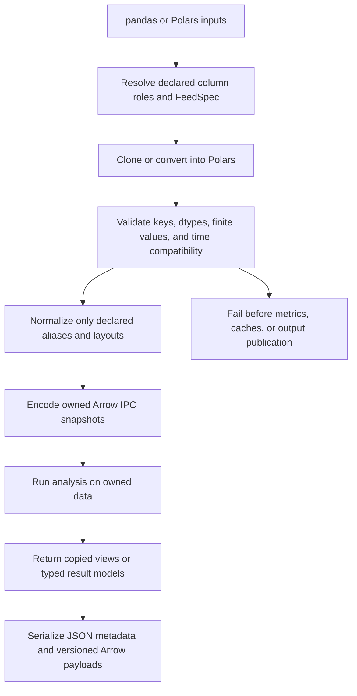

# Data Contracts, Time Semantics, and Owned Results

ML4T Diagnostic treats ingestion as a semantic boundary, not merely a conversion convenience. Public workflows accept several containers, but analysis proceeds only after column roles, keys, value domains, time declarations, and ownership have been resolved. The governing rule is: **preserve what the producer actually reported, reject contradictions, and represent unavailable facts as unavailable**. Returns are not reconstructed from NAV, absent holdings are not empty holdings, unknown fees are not zero, missing timestamps are not synthetic dates, and a forward-return label is not evidence of a calendar duration.

This contract is shared by the portfolio, signal, and backtest integration paths described in [System Map](../architecture/system-map.md), [Backtest to Tear Sheet](../integrations/backtest-to-tearsheet.md), [Portfolio, Trade, and Factor Analysis](../workflows/portfolio-trade-and-factor-analysis.md), and [Signal Analysis](../workflows/signal-analysis.md).

## The boundary in one view

*The ingestion boundary validates meaning before ownership; persistence occurs only after a valid owned snapshot exists.*

## Frame conversion is a one-way normalization boundary

Polars is the internal tabular representation, but pandas remains an accepted public input. Conversion is deliberately explicit:

- Existing `pl.DataFrame` values are cloned rather than retained by reference.
- A pandas `MultiIndex` is reset only where the API defines index levels as columns. A pandas `DatetimeIndex` becomes the declared timestamp column when that column is absent.
- If a pandas frame has both a datetime index and a timestamp column, the two must agree in values and timezone. The code rejects disagreement rather than choosing one source.
- Declared source columns are renamed to canonical internal roles such as `date`, `asset`, and `return`. If both the source and canonical name exist, ingestion rejects the ambiguity.
- Only actual supported layouts are reshaped. For example, portfolio positions may be declared long or wide; an all-cash wide snapshot retains its date rows without inventing a cash asset.

The shared key validator requires key columns to exist and contain no nulls; numeric keys must be finite, and keys that identify observations must normally be unique. Transaction rows are the deliberate exception to uniqueness on `(timestamp, asset)`, because multiple executions can occur for the same asset and instant; a unique `record_id` is retained or generated instead. See [`validation.py`](../../src/ml4t/diagnostic/utils/validation.py) and [`frame_inputs.py`](../../src/ml4t/diagnostic/evaluation/portfolio_analysis/frame_inputs.py).

Conversion does **not** authorize semantic coercion. Asset identifiers remain stable strings or integers, transaction timestamps must be actual `Datetime` values rather than dates promoted to fabricated instants, and pandas/Polars inputs must survive conversion into Arrow-compatible data before they can become owned analytical state.

## Four clocks that must not be conflated

| Concept | What it means | What it does **not** establish |
|---|---|---|
| Observation key | The producer's row identity and order, such as a quote timestamp or zero-based row number | A trading day, session, or equally spaced interval |
| Observation lag or horizon count | Move by *N supplied observations* on a declared grid | *N calendar days*, *N sessions*, or a fixed elapsed duration |
| Calendar/session clock | A named market schedule used when an operation explicitly requests session semantics | Permission to resample or validate every supplied observation automatically |
| Elapsed duration | Difference between two representable instants, encoded in exact nanoseconds | A horizon selector, a session count, or a duration for naive/session labels |

This distinction is operational, not terminological. In signal price outcome construction, a mapping such as `{"5D": 5}` contains a **selector label** and an **observation count**. The generated evidence records `window_unit="observation"`; it shifts over the selected `common_grid` or `per_asset` index and explicitly says that calendar validation was not performed. The text `5D` therefore remains a label for compatibility and presentation—it does not prove five elapsed days or five exchange sessions. Forward endpoints retain `requested_exit_time`, `exit_time`, and `reference_time` so consumers can inspect what actually happened.

Likewise, turnover lags are lags in observed factor dates. Portfolio annualization in row mode requires an explicit `periods_per_year`; the library cannot derive an annual scale from observation order alone. Undated portfolio arrays receive zero-based observation indices for numerical and rolling calculations, while month/year tables and complete calendar reports fail because genuine dates are unavailable.

### Timestamp resolution is lossless, not approximate

Equivalent datetime keys stored at `ms`, `us`, or `ns` resolution can be aligned to the finer unit when the cast round-trips exactly. Distinct nanosecond queries are never rounded together to match a coarser price row. If refinement would overflow or otherwise lose identity, the operation raises `ValueError`. Timezone differences are not “fixed” by this utility: timezone-aware and naive keys, or incompatible zones, remain schema errors rather than triggering an inferred timezone policy.

For supplied long outcomes, `duration_ns` and `return_duration_ns` are derived only when both relevant endpoints are timezone-aware `Datetime` values. The calculation uses exact integer nanosecond coordinates via `Decimal(38,0)` to avoid signed subtraction overflow. For date/session labels or naive keys, duration remains unavailable. If a producer supplies a duration, it must be an exact integer nanosecond value and must agree with the endpoints.

## `FeedSpec` and calendar resolution

`FeedSpec` carries producer declarations such as timestamp and entity column names, timezone, calendar, and time-contract version. Entry points accept either a `FeedSpec` or a mapping and normalize it with `FeedSpec.from_any`. Explicit API aliases may override column names, but conflicting aliases such as `timestamp_col` and `date_col` are rejected. Signal and portfolio boundaries require a distinct, nonempty timestamp role and a single entity role.

Calendar resolution preserves a three-way distinction:

1. **Omitted** (`UNSET_CALENDAR`): consult the producer's resolved `FeedSpec` metadata, then the shared resolver's default behavior.
2. **Named string**: use the consumer's explicit override.
3. **Explicit `None`**: disable calendar/session interpretation and remain in observation-key mode.

The backtest bridge first looks for `result.config.resolved_feed_spec`; only when that is unavailable does it consider legacy `resolved_calendar`, and all cases pass through `FeedSpec.resolve_calendar`. The source of the resolution—argument, `feed_spec`, or default—is recorded in normalization metadata. Explicit `None` must survive wrappers all the way to metrics and reports; it must not silently fall back to the engine calendar. See [`_calendar.py`](../../src/ml4t/diagnostic/integration/_calendar.py).

A resolved calendar is metadata until an operation explicitly consumes session semantics. Portfolio frame normalization retains supplied keys and declares that calendar validation was not performed. Conversely, transaction analysis can aggregate against exchange sessions when a named calendar is selected. Changing a default calendar must therefore never rewrite observation identity or make an incomplete producer feed appear complete.

## Missing, finite, and unavailable samples

Different boundaries intentionally have different sample policies:

- **Already-prepared signal panels are strict.** They must be nonempty; `(date, asset)` must be unique; factor, quantile, and every requested return column must be numeric, nonmissing, and finite. Quantiles must be positive integers and, when a count is declared, lie in `1..quantiles`. No row is cleaned, filled, or rebucketed. Metadata records retained and excluded counts and hashes the exact frame.
- **Portfolio returns are authoritative.** They must be a nonempty, one-dimensional finite simple-return sample with values no lower than `-1`. Missing returns are rejected, not replaced with zero. A dated benchmark is aligned by exact keys without filling; an undated benchmark must match length.
- **Price-derived outcomes retain failure evidence.** Missing grid entries, insufficient tails, missing endpoints, missing prices, undefined returns, and filtered outliers receive explicit `outcome_status` values. `forward_return` is null unless status is `ok`; no endpoint is fabricated.
- **Optional account tables preserve absence.** `positions=None`, `valuations=None`, and `transactions=None` remain absent. Empty, absent, and all-cash snapshots are distinct states. Missing commission and slippage columns become nullable unknown values, not zeros. Unreported NAV is never inferred from holdings or cash.
- **Undefined statistics remain unavailable.** A finite one-observation or constant-return sample can have a defined total return while variance-dependent Sharpe, skewness, beta, or rolling risk values remain `NaN` or null. The system avoids turning an undefined statistic into a reassuring zero.

Forward filling, where explicitly offered for research price outcomes, is an analytical choice with provenance. The result marks whether an analytical fill was used and does not claim that filled values were newly observed or executable. Outcome availability is left unknown when analytical fills or look-ahead-sensitive filtering prevent a defensible publication time.

## Ownership and lifecycle

Two ownership mechanisms coexist:

### Array and cache ownership

`PortfolioAnalysis` normalizes returns, benchmark, and dates before creating any cache. Public `returns` and `benchmark` properties return NumPy copies, while `dates` returns a cloned Polars series. Position frames are cloned or converted. Cached metric, rolling, and drawdown results are returned independently, so mutating either the caller's original input or a previously returned result cannot poison later calculations.

Validation precedes lazy computation and publication. Invalid annualization scales, mismatched benchmarks, or unavailable calendar reports fail before metrics are cached and before an output file is replaced.

### Arrow-backed owned snapshots

`PortfolioInputData` and `SignalResult` retain selected tables as Arrow IPC bytes. Accessors decode a fresh `pl.DataFrame`, preventing a caller from mutating the stored snapshot through an exposed frame. Portfolio metadata is retained as strict JSON and returned as a newly decoded dictionary.

`PortfolioInputData` is a frozen dataclass and distinguishes each absent table with `None`. `SignalResult` is also a frozen dataclass, but “frozen” is only shallow for ordinary nested dictionaries and lists; the strong frame-ownership guarantee comes from private IPC bytes and fresh decoding. Treat result fields as outputs, not as a mutable extension API.

## Result families and serialization

The repository has two complementary result families:

- **Pydantic schemas** derive from `BaseResult`. They forbid extra fields, validate assignment, allow required Polars types, serialize enums by value, and share `created_at`, `analysis_type`, and `version`. Subclasses expose named Polars views through `get_dataframe()`, discovery through `list_available_dataframes()`, schema inspection, summaries, and optional interpretations. Domain models add validators for cross-field consistency.
- **Dataclass results** are used where a lightweight or explicitly frozen analysis object is preferable. `SignalResult` owns signal metrics and optional frame evidence; small helper dataclasses such as `ICStats` provide typed projections from larger Pydantic results. Do not assume every result supports the same mutation or validation behavior merely because both have `to_dict()`-style helpers.

Serialization is similarly contract-specific rather than universal:

- `BaseResult.to_dict()` uses Pydantic's Python-mode dump; `to_json_string()` uses Pydantic JSON serialization. A subclass remains responsible for meaningful dataframe views and summaries.
- `SignalResult.to_json()` converts tuples to arrays, dictionary keys to strings, and non-finite `NaN` values to JSON `null`. Owned frames use tagged `arrow-ipc-base64` objects. `from_json()` validates base64 and Arrow payloads, rejects private frame fields, restores tuple and integer-key shapes, and requires dated turnover and autocorrelation evidence to appear together.
- `PortfolioInputData.to_json()` uses `format_version: 1`, strict JSON (`allow_nan=False`), and one base64 Arrow payload or `null` per known table. Restoration rejects unsupported versions, malformed Arrow, and a missing returns table while preserving the distinction between absent and empty optional tables.

These payloads preserve typed tabular evidence better than converting frames to lists of JSON records. They are persistence contracts: extend them with an explicit version or backward-compatible optional field, never by silently changing the meaning of an existing label, null, or payload.

## Safe-change checklist

Before changing an ingestion or result boundary:

1. Identify whether every time parameter means observation count, session count, elapsed duration, or merely a display label.
2. Preserve `UNSET_CALENDAR` versus explicit `None`; test the value through every wrapper.
3. Reject timezone or timestamp-unit conversions that do not round-trip exactly.
4. Keep absence, an empty table, a null value, and numeric zero distinct.
5. Never synthesize returns, holdings, NAV, fees, executions, dates, prices, availability times, or durations from unrelated evidence.
6. Clone mutable inputs or encode them into owned bytes before caching.
7. Return independent views of owned state and cached outputs.
8. Validate before writing reports or replacing existing files.
9. Version serialized layouts and validate embedded Arrow payloads on load.

Focused regression coverage lives in [`test_portfolio_input_contract.py`](../../tests/test_evaluation/test_portfolio_input_contract.py), [`test_backtest_calendar_contract.py`](../../tests/test_integration/test_backtest_calendar_contract.py), and [`test_time_key_resolution.py`](../../tests/test_signal/test_time_key_resolution.py). Together they pin ownership, unavailable calendar output, benchmark alignment, explicit calendar disabling, required observation annualization, lossless datetime resolution, timezone non-inference, and failure-before-publication behavior.
