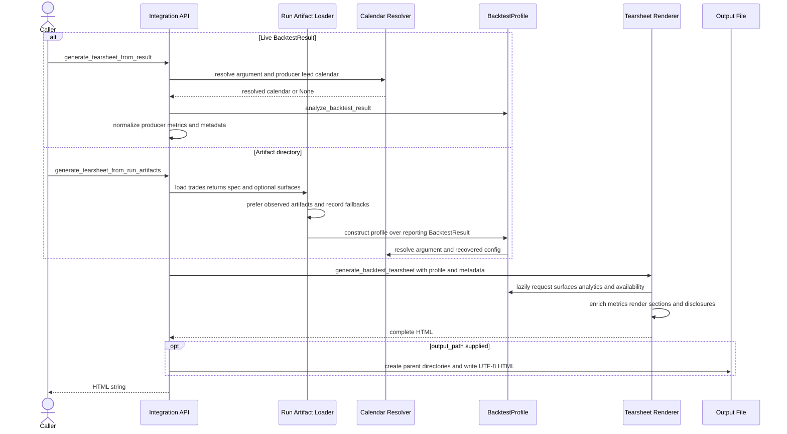

# Backtest and Artifact Integration to Tearsheet

This integration has two producer-facing entry paths:

- `generate_tearsheet_from_result(...)` reports directly from a live `BacktestResult`.
- `generate_tearsheet_from_run_artifacts(...)` reconstructs a `BacktestResult`-compatible reporting envelope from a saved run directory and then reports through the same `BacktestProfile` and renderer.

The boundary is deliberately conservative. It normalizes producer surfaces and metric names, but it does not treat intended weights as executions, infer account cash from exposure, or label a reconstructed equity curve as an observed artifact. For the underlying time and result contracts, see [Contracts, Time, and Results](../concepts/contracts-time-and-results.md). For the larger visualization surface, see [Reporting and Visualization](reporting-and-visualization.md).

## Public entry points and optional dependency

The public functions are exported from `ml4t.diagnostic.integration`:

```python
from ml4t.diagnostic.integration import (
    analyze_backtest_result,
    generate_tearsheet_from_result,
    generate_tearsheet_from_run_artifacts,
    profile_from_run_artifacts,
)
```

Importing `ml4t.diagnostic.integration` does not eagerly require `ml4t-backtest`. Its wrappers lazily import `ml4t.diagnostic.integration.backtest` on first use. If the optional package is absent, a backtest bridge call raises an `ImportError` with the installation instruction:

```text
pip install 'ml4t-diagnostic[backtest]'
```

Directly importing the bridge or `backtest_profile` has the same optional-package requirement. This keeps unrelated integration contracts importable without the backtest extra while making a missing runtime dependency explicit when the bridge is actually used.

## End-to-end convergence



*Both entry paths converge on the lazy profile and the same dashboard/HTML renderer; only the construction and provenance of the input surfaces differ.*

## Calendar and annualization contract

Calendar selection distinguishes omission from explicit `None`:

1. An explicit calendar argument is a consumer override.
2. If omitted (`UNSET_CALENDAR`), the resolver uses the producer's resolved `FeedSpec` calendar, or the compatible config calendar when no feed is present.
3. Explicit `calendar=None` disables session aggregation and retains producer observation returns in their original observation order.
4. The shared `FeedSpec` resolver supplies its normal default only when neither caller nor producer has made a different declaration.

`BacktestProfile.daily_returns` therefore means calendar-aggregated returns when a calendar resolves, but raw `result.to_returns_series()` observations when the resolved calendar is `None`. Annualized performance cannot infer a scale from arbitrary observations. In observation mode, callers **must** provide a positive integer `periods_per_year`; otherwise performance access, portfolio conversion, and tearsheet generation raise `ValueError`. With a named calendar, `ml4t-backtest` supplies the calendar's annualization factor unless the caller supplies a validated override.

The renderer applies one resolved annualization scale to profile analytics, raw-return enrichment, benchmark-relative metrics, factor/statistical calculations, and an `ml4t-periods-per-year` HTML metadata marker. A numerical scale does not assert calendar or bar completeness, and the methodology workspace says so. User-supplied report metadata cannot contradict the profile's resolved calendar; a conflict is rejected before publication.

## Live `BacktestResult` route

`analyze_backtest_result(...)` is intentionally cheap: it stores the result, calendar, benchmark, confidence-interval choice, and optional annualization factor in a `BacktestProfile`. Surface exports and analytical families are evaluated only when their properties are requested and then cached per profile.

The live report wrapper performs these preparations:

- resolves the profile and obtains trades, returns, and equity through public result exports;
- aliases producer metric spellings such as `sharpe`/`sharpe_ratio`, `sortino`/`sortino_ratio`, `calmar`/`calmar_ratio`, `num_trades`/`n_trades`, and converts `total_return_pct` to a fraction;
- computes missing profile metrics without overwriting most producer values, while deliberately replacing turnover and unavailable profit-factor values with the diagnostic interpretation;
- normalizes drawdown magnitude to positive report convention and adds trade P&L when needed;
- constructs metadata for strategy identity, universe, benchmark, evaluation window, run/library identity, calendar, execution mode, costs, available surfaces, and ML coverage;
- merges caller metadata field by field over generated fallback metadata, then pins the calendar to the resolved analytical calendar.

`BacktestProfile` exposes raw trades, fills, portfolio-state, equity, predictions, and mapped signals. Optional prediction/signal surfaces may come from current or compatibility method/attribute names. Normalization maps `symbol` to `asset`, date-like columns to `timestamp`, common prediction columns to `prediction_value`, and `signal` or `weight` to `signal_value`. Failed optional conversions or prediction-to-trade enrichment warn and make the affected optional view unavailable rather than corrupting the core report.

## Saved artifact route and reconstruction provenance

`profile_from_run_artifacts(...)` requires `trades.parquet` and `daily_returns.parquet`; normal file and schema errors propagate if they cannot be read. It also consults these optional inputs:

| Input | Behavior |
|---|---|
| `spec.json` | Recovers `BacktestConfig`, feed column names, strategy metadata, initial cash, and prediction linkage. Missing means an empty spec. Invalid config parsing emits a warning and uses defaults. |
| `equity.parquet` | Preferred as the observed equity artifact. If absent, equity is compounded from `daily_returns.parquet` and initial cash, and marked `reconstructed from daily returns`. |
| `portfolio_state.parquet` | Restores account-state snapshots. If absent, the surface stays empty and is marked unavailable. |
| `fills.parquet` | Restores execution records. If absent, the surface stays empty and is marked unavailable. |
| `weights.parquet` or `signals_path` | Normalized to a signal-shaped surface with `weight` renamed to `signal_value`; provenance says it is derived from portfolio weights, not model signals. |
| `predictions_path` | Explicit path wins. Otherwise the loader follows `prediction_hash` in the spec, then optionally queries the run-log `registry.db`. Registry errors warn and leave predictions unavailable. |

Feed-declared timestamp and entity columns are normalized before the profile consumes predictions or weights. The loader also finds the earliest active return, trade, or nonzero weight and trims pre-live warm-up rows when those clocks can be compared safely. If candidate timestamps mix timezone-aware and naive values, it declines to guess a boundary and retains the observations.

The artifact route creates a reporting `BacktestResult` from loaded trades, equity, fills, config, and portfolio state, then supplies prediction/signal and strategy-metadata overrides to `BacktestProfile`. This is a compatibility envelope, not proof that every enclosed surface was emitted by the engine.

> **Provenance invariant:** reconstructed or derived surfaces must never be presented as observed artifacts. Missing fills and portfolio state remain missing. Target weights cannot establish fill price, quantity, commission, cash, or account equity. Reconstructed equity remains explicitly labeled, and weight-derived signals must not be described as model signals.

`profile.data_sources` carries this distinction into metadata and visualization. Section-level warnings are attached to equity-, fills-, and portfolio-state-dependent panels when their source is anything other than `artifact`. The methodology workspace displays artifact badges or warning badges and explains that reconstructed data should be replaced by rerunning with engine-path artifact saving. This provenance is also summarized in `BacktestReportMetadata.data_summary`.

## Lazy analytical profile and availability

The profile computes each family once on first access:

| Family | Required surface and result |
|---|---|
| `performance` | Return observations and equity; Sharpe, Sortino, CAGR, volatility, Calmar, drawdown, total return, and rolling stability. |
| `edge` | Trades; closed-trade count, win rate, profit factor, expectancy, fees, slippage, duration, and symbol P&L. |
| `activity` | Fills, with portfolio state for normalized turnover/cost drag; also rebalance and raw notional/cost summaries. |
| `occupancy` | Portfolio state; time in market, positions, and exposure ratios. |
| `attribution` | Trades and/or fills; symbol P&L, turnover, implementation-cost burden, contributors, and drags. |
| `drawdown` | Equity plus trades; episodes and peak-to-trough negative contributors. |
| `ml` | Predictions, signals, and strategy metadata; surface counts, selection/link coverage, translation readiness, and prediction/trade alignment. |

`summary` flattens the principal performance, edge, activity, occupancy, and drawdown metrics for legacy bridge compatibility. More structured frames remain in their family properties.

Availability is not a Boolean. Every raw surface, analytical family, and selected metric is classified as `available`, `partial`, `unavailable`, or `degraded`, with an optional reason, coverage, and fallback. Important examples are:

- execution audit is available only when quote-aware fill coverage meets the default `0.8` threshold, partial below it, and unavailable with no quote evidence;
- activity with fills but no portfolio state is degraded: raw counts/notional remain valid, but turnover and time-series cost drag do not;
- attribution with only trades or only fills is degraded but can still show partial symbol views;
- ML is available only with both predictions and signals, partial with one, and unavailable with neither;
- occupancy and activity normalization report exactly how many observations have finite positive equity. Undefined ratios remain gaps rather than being coerced to zero.

These states drive report disclosures. Occupancy and activity sections print normalization coverage and denominator requirements, while missing data generally causes a renderer to return no section rather than invent a chart.

## Renderer preparation and HTML assembly

`generate_backtest_tearsheet(...)` accepts a profile or lower-level trades, returns, equity, metrics, and optional prediction/factor inputs. With a profile it fills missing inputs from the profile and merges profile metrics without overwriting explicit metrics. It then:

1. validates the annualization scale and return/benchmark compatibility;
2. enriches portfolio, benchmark-relative, and trade summary metrics;
3. optionally computes statistical validation metrics;
4. enables ML or factor sections when their real inputs are present;
5. renders enabled sections through a registry into persona workspaces (`overview`, `performance`, `trading`, `validation`, `factors`, `ml`, and `methodology`);
6. arranges paired, sidebar, and collapsible sections in the dashboard shell;
7. embeds Plotly JavaScript when requested, adds the annualization metadata marker, and returns a complete HTML document.

`include_statistical=False` omits inference enrichment and the statistical validity, confidence, track-record, bootstrap, and credibility sections; descriptive drawdown reporting remains. Templates and themes affect presentation and workspace selection, not source provenance.

`BacktestReportMetadata` does not invent a visible strategy title: title resolution uses explicit title, then strategy name, then an empty heading, while the browser document title falls back to `Backtest Report`. Metadata merge semantics preserve caller-provided nonempty fields and fill only gaps from generated values.

## Failure and publication semantics

Failures remain visible at the boundary:

- missing optional `ml4t-backtest` raises the installation-focused `ImportError`;
- invalid annualization or a calendar conflict raises `ValueError` before HTML is written;
- required artifact read/schema failures propagate; config and registry recovery are the exceptions that warn and degrade optional context;
- statistical-enrichment failures and individual section failures are wrapped in `ReportGenerationError` with phase or section context and the original cause;
- unknown or data-inapplicable sections return `None` and are omitted, but unexpected rendering exceptions do not silently disappear;
- output parent directories are created automatically, and HTML is written as UTF-8 only after generation reaches the write step.

For the live wrapper, writing occurs after the renderer returns. The artifact wrapper delegates `output_path` to the same renderer. Consequently, validation or rendering failure does not publish a newly generated report at the requested path. Ordinary filesystem errors during directory creation or writing propagate.

## Safe extension points

When extending this path:

- add a new raw surface to `BacktestProfile` with normalization and an explicit availability definition before consuming it in charts;
- preserve lazy caching so requesting one report family does not eagerly compute every analysis;
- register a renderer and map it to a workspace, data dependencies, and methodology disclosure where applicable;
- add source provenance whenever an artifact fallback derives rather than observes values;
- carry `periods_per_year` through every computation that annualizes instead of falling back to sample length;
- prefer a missing/degraded state over fabricated execution or account data.

Portfolio, trade, and factor analyses that consume these surfaces are described in [Portfolio, Trade, and Factor Analysis](../workflows/portfolio-trade-and-factor-analysis.md).

## Focused verification

The most consequential tests establish the contracts rather than only checking HTML snapshots:

- `test_backtest_calendar_contract.py` proves omission versus explicit `None`, required observation-mode annualization, metadata conflict rejection, and no output on invalid calls.
- `test_artifact_execution_availability.py` proves that weights-only exports do not fabricate fills or account state.
- `test_backtest_profile.py` covers lazy family outputs, prediction/signal normalization, ML translation states, quote coverage, and drawdown contributors.
- `test_backtest_result.py` exercises prediction lookup, feed-column normalization, warm-up trimming, metric aliases, metadata forwarding, and the artifact-to-ML-workspace journey.
- `test_report_disclosure_marker.py` opens a real generated report at desktop and mobile widths to verify disclosure controls and rebalance rows without browser errors.
- `test_producer_report_journeys.py` verifies a real producer account retains initial capital, external flows, fees, and observed returns into final reporting rather than reconstructing a different account history.

See the implementation in [`integration/backtest.py`](../../src/ml4t/diagnostic/integration/backtest.py), [`integration/backtest_profile.py`](../../src/ml4t/diagnostic/integration/backtest_profile.py), and [`visualization/backtest/tearsheet.py`](../../src/ml4t/diagnostic/visualization/backtest/tearsheet.py).
