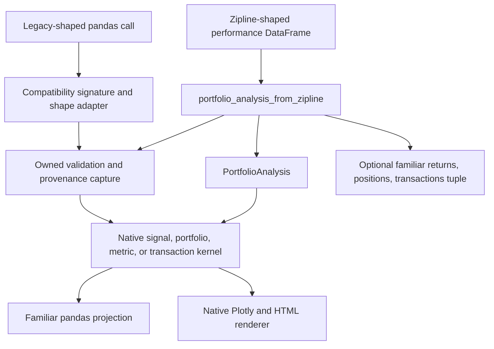

# Alphalens, Empyrical, Pyfolio, and Zipline Compatibility

The compatibility layer is a **migration surface**, not a frozen copy of four analytics projects. It accepts familiar pandas-oriented signatures and result shapes, translates them into owned inputs, invokes ML4T Diagnostic's native analytical kernels, and projects the result back into familiar tables or into the native Plotly/HTML reporting model. Native APIs and defaults remain authoritative; compatibility-specific conventions are explicit and local to `ml4t.diagnostic.compat`.

This distinction matters during migration: parity is retained where it describes a useful input, formula, or table contract, but it does not grant old code permission to bypass current validation, infer missing account facts, import a legacy engine, or mutate Matplotlib artists.

## Architecture and dependency boundary

The public compatibility namespaces are `ml4t.diagnostic.compat.alphalens`, `ml4t.diagnostic.compat.empyrical`, and `ml4t.diagnostic.compat.pyfolio`. Pyfolio is imported lazily by the parent package, and its plotting module is itself lazy, keeping analytical imports separate from rendering imports. Zipline-shaped output enters through `ml4t.diagnostic.integration.zipline.portfolio_analysis_from_zipline`; the familiar Pyfolio tuple extractor delegates to that same owned boundary rather than parsing the account a second time.

*The adapter translates at the boundary; validation, calculations, and report ownership remain native and shared.*

There is no hidden runtime dependency on Zipline, Pyfolio, Alphalens, or Empyrical. The Zipline integration intentionally consumes plain pandas data, mappings, integer SIDs, or objects exposing a small attribute protocol; a subprocess test blocks all four legacy packages and still constructs native transaction inputs. Reference packages appear only in optional qualification tests that compare results when those packages happen to be installed. Rendering uses Plotly and offline HTML, not Matplotlib; visualization entrypoints may therefore require Diagnostic's visualization extra, but importing the analytical compatibility namespace does not mean importing the old visualization stack.

## Adapter map

| Migration surface | Familiar contract retained | Native implementation reused | Result boundary |
|---|---|---|---|
| Alphalens preparation | pandas `factor` Series with a date/asset `MultiIndex`, wide prices, forward-return duration labels, group/quantile arguments, `max_loss` | `price_outcomes`, `prepare_signal_panel`, `PolarsBackend.fast_quantile_assignment`, and the shared signal input contract | Familiar clean pandas factor table with restored opaque asset IDs and diagnostic metadata |
| Alphalens performance | weights, factor returns, alpha/beta, IC, quantile statistics, turnover, positions, and event-study signatures | `ml4t.diagnostic.signal` portfolio, regression, IC, quantile, turnover, positions, and event kernels | pandas Series/DataFrames shaped like Alphalens outputs |
| Alphalens tears and plots | familiar sheet names and options such as `long_short`, `group_neutral`, `by_group`, and `return_fig` | `PreparedSignalPanel`, native signal analyses, `generate_signal_report`, and `plot_signal_report` | Offline HTML/display side effect or ordered Plotly figures |
| Empyrical | scalar, columnwise, rolling, benchmark, capture, tail-risk, and holdings-attribution signatures; periodic risk-free/MAR arguments | portfolio-analysis metrics plus shared risk-adjusted, attribution, rolling, and benchmark helpers | scalar, NumPy, Series, or DataFrame output according to the supplied shape |
| Pyfolio analytics | return, position, transaction, round-trip, capacity, and supplied-factor-attribution signatures | owned portfolio-analysis inputs and metrics, FIFO round trips, holdings/transaction/capacity/attribution kernels | familiar pandas tables and native result objects |
| Pyfolio tears and plots | simple/full/component tear-sheet entrypoints and `return_fig` behavior | `PortfolioTearSheet`, portfolio dashboards, and HTML report generation | native `PortfolioTearSheet`, Plotly figures, or standalone HTML |
| Zipline result ingestion | `run_algorithm`-style performance rows containing reported returns and optional nested positions/transactions/account values | `PortfolioAnalysis.from_frames` and all downstream native analyses | a provenance-bearing `PortfolioAnalysis`; optionally projected to the familiar Pyfolio tuple |

For end-user analytical flow, see [Signal Analysis](../workflows/signal-analysis.md) and [Portfolio, Trade, and Factor Analysis](../workflows/portfolio-trade-and-factor-analysis.md). Report ownership and output formats are covered in [Reporting and Visualization](reporting-and-visualization.md).

## Alphalens migration semantics

### Preparation is translation, not a parallel cleaner

`compute_forward_returns` validates the pandas date/asset keys, price index, timezone agreement, horizon counts, and uniqueness, then calls the native price-outcome path. Its legacy duration labels are inferred from observed timestamps and an observation calendar; they are **labels**, not proof that an exchange schedule was validated. The adapter also preserves the legacy forward-fill and optional look-ahead z-score filtering conventions, but records the price preparation, calendar contract, reference profile, and label method in `DataFrame.attrs["diagnostic"]`.

`get_clean_factor` encodes opaque pandas asset identifiers into call-local integers, invokes the single `prepare_signal_panel` cleaner, then restores the original identifiers and column layout. Quantization likewise routes to `PolarsBackend.fast_quantile_assignment`; `no_raise=True` drops only the failed date/group. Duplicate bin-edge errors are translated into migration-oriented guidance rather than replaced with different bucketing logic.

Supported reference profiles are explicit: `reference_version` is limited to `"0.5.0"` and `"0.4.6"`. Profile switches control documented compatibility choices such as spread exposure and date-grid behavior. They do not alter native defaults outside the adapter.

### Statistics and reports reuse signal ownership

The performance facade converts a clean pandas factor table once, then delegates factor weights and returns, alpha/beta regression, IC, quantile summaries, event paths, turnover, and portfolio positions to `ml4t.diagnostic.signal`. Tear sheets wrap that table in `PreparedSignalPanel.from_prepared`, so already-supplied buckets are not silently recomputed. Returns, information, and turnover results then flow into the native signal report generator.

Some defects or ambiguous claims from the historical implementations are deliberately rejected. For example, unidentified alpha/beta fits remain unavailable instead of being turned into zero returns or zero beta; supplied return series are not renamed in place; and full factor reports do not invent an execution account. Annualization conventions used solely for compatibility are passed explicitly to native kernels.

## Empyrical migration semantics

`compat.empyrical` retains familiar constants and function names while making unit and missingness rules visible:

- `risk_free` and minimum acceptable return arguments are **periodic**, as in the compatibility contract. Native APIs that accept annual rates are not changed.
- Annualization must be a positive finite number. Named periods resolve through the compatibility factor table.
- Compounding uses the native NaN-neutral safe product; drawdown includes initial capital; annual return counts supplied rows as elapsed observations, while means and deviations omit undefined adjusted observations according to the metric.
- pandas labels are preserved for columnwise results, including Sortino labels. `calmar_ratio` intentionally remains one-dimensional and tells callers to apply it per column.
- `aggregate_returns` requires a `DatetimeIndex` and uses observed civil-time groups. It does not invent an exchange calendar.
- `out` buffers and ndarray paths are retained where meaningful, but shape, overlap, and ownership checks in the shared return helpers prevent unsafe aliasing.

The facade delegates core compounding, annual return, volatility, drawdown, Calmar, Omega, tail ratio, stability, VaR, and tail calculations to native portfolio/risk kernels. Benchmark, rolling, capture, fragility, tail-risk, and holdings-attribution families live in focused compatibility helpers, allowing legacy shape and edge conventions without duplicating the native financial primitive.

## Pyfolio migration semantics

Pyfolio compatibility has two layers:

1. Analytical adapters normalize supplied returns, holdings, fills, and factors and invoke native portfolio kernels.
2. Sheet adapters compose those results with the owned `PortfolioTearSheet`, portfolio dashboards, or standalone HTML generator.

`create_simple_tear_sheet` and `create_full_tear_sheet` preserve the familiar account-oriented call shape. Optional holdings, transactions, market data, capacity, factor attribution, and round trips enable only their dependent sections. Missing inputs are reported as unavailable; they are not replaced with broker history, inferred fills, or fabricated returns. Round trips use actual FIFO inputs, and any hypothetical terminal closing rows remain separately identified rather than becoming actual execution or realization facts.

`create_perf_attrib_tear_sheet` consumes supplied returns, positions, factor returns, and factor loadings, computes attribution once through shared kernels, and returns either ordered Plotly figures or offline HTML. Position and transaction sheets preserve explicit intraday-estimation choices and cost assumptions in metadata. The full report propagates annualization and turnover choices to selected components instead of letting each panel silently choose its own scale.

### Deliberate visualization break

The plotting adapters preserve financial arguments, not the Matplotlib object model. They return Plotly figures supporting `show`, `write_html`, and `to_dict`. A supplied `ax` is rejected with an instruction to remove it, and callers cannot rely on Matplotlib artist mutation, shared-axis side effects, implicit notebook display, or old style-context behavior. Alphalens table helpers return HTML or DataFrames rather than Matplotlib tables. Use `return_fig=True` when composition or testing needs owned figure objects; otherwise tear-sheet entrypoints display or return HTML according to their documented route.

## Zipline result adapter

`portfolio_analysis_from_zipline` treats reported `returns` as authoritative and validates the DataFrame before any analysis. The index must be a `DatetimeIndex`, columns must be unique, and nested `positions` and `transactions` cells must be actual lists or tuples of records. Missing snapshots are not interpreted as empty books; an explicit empty list proves an all-cash position date or no fills.

Asset identity is the stable integer `sid`, never a symbol. A mapping descriptor can carry `sid`, `symbol`, and multiplier; a producer object can expose `sid`, `symbol`, and `price_multiplier` without importing Zipline. Raw integer SIDs require declared finite positive multipliers in the native adapter. Marked position value is `amount * last_sale_price * multiplier`; futures notional therefore remains distinct from producer-reported cash and NAV. Repeated assets in one complete snapshot, non-finite amounts or marks, and transactions without actual execution `dt` values fail early.

Optional columns enable only their corresponding ledgers:

- `portfolio_value` and `ending_cash` become producer-owned equity and cash valuations.
- Complete `positions` snapshots are expanded across known SIDs, allowing absent assets to be zero only because completeness was explicitly established.
- `transactions` preserve execution instants and per-record commission/slippage. Aggregate portfolio costs are never apportioned to fills.
- If only returns exist, summary statistics still work while holdings, transaction, and valuation analyses remain unavailable.

After `PortfolioAnalysis.from_frames` performs native schema and temporal validation, the adapter records JSON-safe source provenance: source format, whether NAV and cash were reported, asset label observations, position-value derivation, and the execution-cost policy. The input frame is deep-copied along the way and is not mutated.

The familiar `extract_rets_pos_txn_from_zipline` route first requires positions, transactions, and cash, then delegates validation and extraction to `portfolio_analysis_from_zipline`. It projects owned results into daily returns, marked positions plus cash, and actual fills. Civil-day return labels and transaction instants retain their distinct semantics. This is a projection from the native source of truth, not an independent Zipline parser.

## What compatibility intentionally does not promise

- **No legacy runtime lifecycle.** There is no Zipline algorithm execution, broker state, data portal, Alphalens/Pyfolio global context, or Empyrical installation behind these calls.
- **No weakening of native validation.** Familiar signatures do not permit duplicate keys, ambiguous calendars, guessed multipliers, non-finite account facts, or missing records to masquerade as valid data.
- **No inferred provenance.** Observation calendars, price basis, annualization, reference profile, intraday estimates, synthetic closing rows, and supplied-vs-derived values remain explicit in arguments or metadata.
- **No universal bug-for-bug parity.** Known defects, misleading zero substitutions, accidental label loss, or assumptions that would fabricate account state are rejected.
- **No Matplotlib compatibility contract.** Plotly figures replace axes and artists; mutation of a passed artist is unsupported.
- **No second analytics implementation.** A compatibility helper may translate units, labels, shape, or a documented edge convention, but the financial calculation belongs in a native signal, metric, portfolio, or report kernel.

## Extending an adapter safely

Treat a new legacy function as a boundary translation exercise:

1. **Identify the native owner first.** Map the calculation to a signal, portfolio, metric, transaction, attribution, or report kernel. If none exists, add or improve the native kernel before exposing the compatibility signature.
2. **Write the semantic delta down.** State input units, annualization, missing-value behavior, index/calendar assumptions, reference version, output labeling, and any compatibility-only edge behavior. Do not silently change the native default.
3. **Validate before coercion.** Reject ambiguous keys, dimensions, timestamps, multipliers, and boolean-as-number values before converting to arrays or Polars. Distinguish absent data from an explicitly empty complete ledger.
4. **Preserve ownership and identity.** Copy caller inputs, retain stable IDs independently from display labels, and never overwrite producer-reported NAV/cash with marked exposure.
5. **Delegate once.** Adapt into the native input/result model, call the shared kernel, then perform only the output projection. Do not copy formulas into a second module merely to match a legacy name.
6. **Record provenance.** Attach enough metadata to explain source format, compatibility profile, calendar and price assumptions, derived fields, synthetic rows, and unavailable sections.
7. **Keep optional dependencies at the edge.** Use local imports for rendering. Do not import a legacy project to implement production behavior. Return Plotly/native report objects and reject Matplotlib `ax` semantics explicitly.
8. **Test both compatibility and divergence.** Add fixture-based signature/shape tests, native-kernel equivalence tests, failure tests for ambiguous data, input non-mutation checks, and optional reference-package parity tests. Test intentionally rejected behavior as carefully as retained behavior.

## Focused verification

The highest-value tests are organized by responsibility:

- `tests/test_compat/test_alphalens_preparation.py`, `test_alphalens_statistics.py`, and the composed-sheet tests verify key restoration, cleaner delegation, profiles, familiar shapes, and report composition. `tests/test_signal/test_correctness_vs_alphalens.py` is an optional qualification suite comparing native signal statistics to an installed Alphalens reference; the reference is not needed in production.
- `tests/test_compat/test_empyrical_scalar_metrics.py`, `test_empyrical_return_paths.py`, `test_empyrical_rolling.py`, and `test_empyrical_buffer_ownership.py` cover formulas, labels, missingness, rolling paths, and buffer safety. Optional tests compare the shared sample against published Empyrical.
- Pyfolio tests are split by account, returns, positions, transactions, round trips, capacity, and attribution. Notebook-migration and plotting tests assert the Plotly return contract rather than Matplotlib mutation.
- `tests/test_integration/test_zipline_result_adapter.py` uses a captured Zipline 3.2 account to verify holdings, costs, all-cash dates, futures multipliers, stable SIDs, unknown optional ledgers, non-mutation, native reporting, and operation while legacy imports are actively blocked.

These tests encode the architectural invariant: compatibility may preserve a familiar way to ask, but native validated data and kernels decide what can truthfully be computed.
