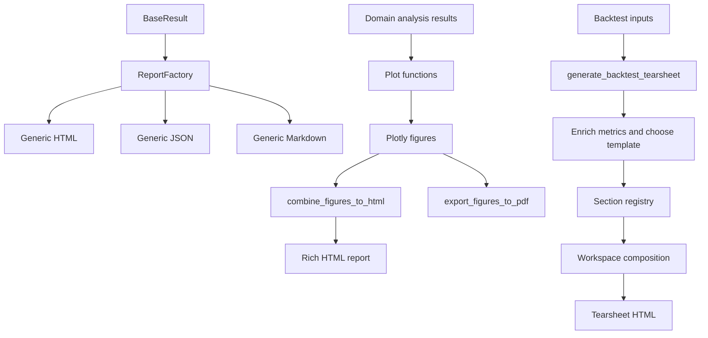

# Reporting and Visualization Boundaries

ML4T Diagnostic has two separately owned reporting systems:

1. `ml4t.diagnostic.reporting` serializes any `BaseResult` into generic HTML, JSON, or Markdown. It is a small renderer factory, not a dashboard composer.
2. `ml4t.diagnostic.visualization` owns Plotly figures, feature-analysis reports, portfolio and signal dashboards, and the domain-specific backtest tearsheet. It decides which analytical sections belong together and how they are laid out.

There is also an older, feature-diagnostics-specific module at `ml4t.diagnostic.evaluation.report_generation`. Its `generate_html_report`, `generate_json_report`, and `generate_markdown_report` functions know the concrete `FeatureDiagnosticsResult` fields. They are not the generic `ReportFactory`, nor are they the backtest tearsheet.

## Boundary at a glance

| Need | Entry point | Input contract | Output/composition responsibility |
|---|---|---|---|
| Serialize a structured result | `ReportFactory.render(result, ReportFormat.*)` | `BaseResult` | Metadata, `summary()`, and result-provided DataFrames; no analytical plot selection |
| Combine already-created Plotly figures | `combine_figures_to_html(...)` | `list[go.Figure]` plus optional section dictionaries | Figure order, narrative sections, TOC, theme, and HTML document |
| Build feature importance/interaction reports | `generate_importance_report`, `generate_interaction_report`, `generate_combined_report` | Domain result dictionaries | Chooses plots and narrative for those analyses, then delegates HTML assembly |
| Build a backtest dashboard | `generate_backtest_tearsheet(...)` or `BacktestTearsheet` | Profile, trades, returns, metrics, predictions, factors, and related context | Metric enrichment, template selection, section dispatch, workspace ordering, Plotly/HTML rendering, and final document |
| Run the interactive trade SHAP application | `streamlit run -m ml4t.diagnostic.evaluation.trade_dashboard.app` | Trade SHAP result or upload | Streamlit application lifecycle and tabs; separate from HTML report generation |



*The generic renderer branch serializes result objects, while visualization branches compose domain-owned plots and report sections.*

## Generic structured-result rendering

`ReportFormat` is a closed enum containing `HTML`, `JSON`, and `MARKDOWN`. `ReportFactory` maintains a class-level mapping from format to `ReportGenerator` class. Importing `ml4t.diagnostic.reporting` imports all three renderer modules; each module registers itself as an import side effect. `create()` instantiates the registered class, `render()` is a create-and-render convenience method, and an unregistered format raises `ValueError`. `ReportGenerator.save()` only creates parent directories and writes UTF-8 text.

The renderers intentionally stay generic:

- JSON delegates to `BaseResult.to_json_string()` or uses `to_dict(exclude_none=True)` before `json.dumps`.
- HTML derives a title from `analysis_type`, includes result metadata and `summary()`, and optionally renders the DataFrames advertised by `list_available_dataframes()` and `get_dataframe()`.
- Markdown follows the same metadata/summary/DataFrame model in a text-friendly form.
- HTML defaults to 50 displayed rows per table; Markdown defaults to 10. Both tolerate results that do not implement usable DataFrames by catching `NotImplementedError` or `ValueError`.

This package does **not** decide that a strategy needs an equity curve, that feature importance needs an agreement heatmap, or that a report should have workspaces. Those are domain composition decisions and belong under `visualization`.

The factory registry is replaceable rather than append-only: registering another class for an existing `ReportFormat` replaces the previous mapping. Tests deliberately replace the JSON generator and restore it. Because `ReportFormat` is an enum, adding a genuinely new generic output format requires more than calling `register()` with an arbitrary string.

## Plotly report composition

`combine_figures_to_html` is the generic composition primitive on the visualization side. It validates that there is at least one `go.Figure`, rejects non-Figure entries, validates every section's `figure_index`, applies a named theme, converts each figure to an HTML fragment, and builds one document. Only the first figure includes Plotly.js; later figures reuse it. With `output_file=None` it returns HTML, while an output path is written through a temporary file and atomically replaced.

The `sections` argument owns narrative structure. Each dictionary may provide a title, text, and a `figure_index`; figure indices refer to the original list. If sections are omitted, figures are emitted sequentially. The default `include_plotlyjs="cdn"` creates a report that loads Plotly.js from the network. Pass `include_plotlyjs=True` when an offline, embedded Plotly.js payload is required.

The feature report helpers sit one level above this primitive. They create importance and interaction plots, decide which sections and recommendations appear, and optionally trigger PDF export. A new standalone plot should normally live beside the analytical domain that computes its display data—such as `feature_plots.py`, `interaction_plots.py`, or a package under `signal/`, `portfolio/`, or `factor/`—and be re-exported through the appropriate package API. A new feature-report section belongs in the corresponding `generate_*_report` composer, where its figure and section dictionary are added together and tested for section selection, invalid names, themes, and output integrity.

## Backtest tearsheet composition

The backtest tearsheet is a richer owned system, not a renderer registered with `ReportFactory`. `generate_backtest_tearsheet` accepts either a prepared `BacktestProfile` or lower-level trades, returns, equity, metrics, predictions, benchmark, SHAP, factor, and report metadata inputs. It then:

1. validates supplied domain results that must correspond to the report's returns;
2. resolves the annualization scale;
3. hydrates missing inputs and metrics from a profile;
4. enriches portfolio, benchmark-relative, trade, and—when enabled—statistical metrics;
5. enables data-dependent ML and factor sections;
6. resolves a persona template and dashboard preset;
7. renders enabled sections through `_SECTION_REGISTRY`;
8. groups rendered sections into ordered workspaces; and
9. fills the tearsheet HTML shell and optionally writes it.

Templates (`quant_trader`, `hedge_fund`, `risk_manager`, and `full`) define `TearsheetSection` records with a stable name, title, narrative band, enabled state, and priority. The section registry maps those names to renderers receiving a shared `_SectionContext`. A renderer may return a Plotly figure, an HTML string, or `None`; `None` omits a section when its required data is unavailable. Rendering failures are wrapped as `ReportGenerationError` with the section name, rather than silently producing a broken panel.

`BacktestTearsheet` is the stateful builder for the same system. Its `add_*` methods accumulate profile/data/metrics/context, `enable_section()` and `disable_section()` mutate the stored template, and `generate()` uses that exact template so custom section state is preserved. The function entry point is preferable for one-shot composition; the builder is useful when callers progressively assemble report context.

The tearsheet's `include_plotlyjs=True` has different semantics from `combine_figures_to_html(..., include_plotlyjs=True)`: it inserts a fixed Plotly CDN script tag. Setting it to `False` is appropriate only when the containing page already loads a compatible Plotly.js runtime. It does not embed Plotly.js for offline use.

For more on supplying backtest artifacts and profiles, see [Backtest to Tearsheet](backtest-to-tearsheet.md). Portfolio and factor producers are described in [Portfolio, Trade, and Factor Analysis](../workflows/portfolio-trade-and-factor-analysis.md), while signal report producers are covered by [Signal Analysis](../workflows/signal-analysis.md).

## Optional dependencies and export paths

Install optional runtimes only for the path that uses them:

| Path | Requirements |
|---|---|
| Generic HTML/JSON/Markdown via `ml4t.diagnostic.reporting` | Core package only; no Plotly, Kaleido, browser, Streamlit, or PDF merger |
| Plotly figures, rich HTML reports, and tearsheets | `ml4t-diagnostic[viz]`, principally Plotly |
| HTML viewed with CDN-backed Plotly.js | Network access at viewing time; no Kaleido or local browser renderer |
| Static Plotly image or PDF rendering | Kaleido; current Kaleido releases may also require local Chrome or Chromium |
| Multi-page `export_figures_to_pdf` | Kaleido for each page and `pypdf` (or the supported `PyPDF2` fallback) to merge pages |
| Interactive trade dashboard | `ml4t-diagnostic[dashboard]` and Streamlit; unrelated to ordinary HTML/PDF generation |

The `viz` extra includes Plotly, Kaleido, `pypdf`, and process-management support. `export_figures_to_pdf` checks for Kaleido, supports only `layout="vertical"`, copies figures before applying print dimensions, renders one temporary PDF per figure, merges those pages, and atomically replaces the destination. `layout="compact"` currently raises `NotImplementedError`; invalid layouts and empty/non-Figure inputs fail before rendering. Rendering failures propagate. Chrome or Chromium is therefore an operational concern for the Kaleido static-export path, not for JSON/Markdown rendering or ordinary browser-hosted interactive HTML.

## Where to make a change

### Add a generic format

1. Add a `ReportFormat` member.
2. Implement `ReportGenerator.render(result: BaseResult, **options) -> str` in `ml4t.diagnostic.reporting`.
3. Register the class and import its module from `reporting/__init__.py`, otherwise normal package import will not populate the registry.
4. Test direct rendering, factory creation, option forwarding, save behavior, and the unregistered failure case.

Do not add a generic format merely to expose a domain dashboard. A renderer should depend only on the `BaseResult` contract; if it needs backtest trades, feature-method agreement, signal quantiles, or factor context, it belongs to the visualization/domain layer.

### Add a Plotly plot or composed feature section

Keep numerical analysis outside the plotting function where possible. Add the plot in the owning visualization module, make theme and input validation consistent with neighboring plots, expose it through the relevant `__init__.py`, and test the figure's traces/layout under representative inputs. To place it in a feature HTML report, update the domain `generate_*_report` composer so figure ordering and `figure_index` remain aligned.

### Add a backtest tearsheet section

A complete section change usually spans four coordinated points:

1. implement a renderer that consumes `_SectionContext` and returns `go.Figure`, HTML, or `None`;
2. add its stable name to `_SECTION_REGISTRY`;
3. add a `TearsheetSection` to the intended persona templates with band, priority, and default enabled state;
4. map/order it in the dashboard workspace/preset layer and add an integration test that generates the tearsheet with and without the required data.

If the section is statistical, factor-specific, ML-specific, collapsible, title-free, or requires a provenance warning/footnote, update those policy sets and mappings too. Merely writing a plotting function does not make it appear in a tearsheet; composition remains explicit.

## Focused verification

Use the smallest suite that owns the changed boundary:

```bash
pytest tests/test_reporting/test_renderers.py
pytest tests/test_visualization/test_report_generation.py
pytest tests/test_visualization/test_backtest.py
pytest tests/test_visualization/test_pdf_report_lifecycle.py tests/test_visualization/test_pdf_process_ownership.py
pytest tests/test_evaluation/test_report_generation.py
```

The reporting tests cover renderer options, table formatting, registry creation/replacement, and invalid registration state. Visualization report tests cover section selection, themes, CSS/document output, PDF validation, and multipage export. Backtest tests cover plots and their tearsheet integration. The evaluation report suite belongs to the concrete `FeatureDiagnosticsResult` report module and should be run when changing that legacy/domain-specific path, not for an isolated generic renderer change.
