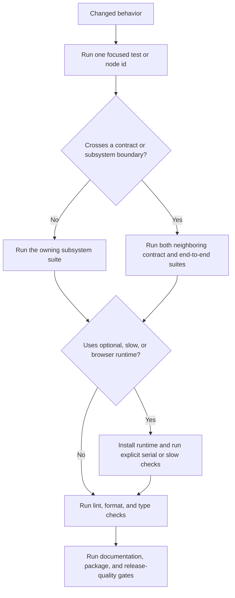

# Development, Testing, and Safe Change Strategy

This repository treats numerical behavior, public imports, documentation examples, package artifacts, and integration boundaries as parts of the product contract. The safe development loop is therefore **focused test first, neighboring contracts second, broad qualification last**. Start with the narrowest test that can disprove the change, but do not stop there when a change crosses subsystem or package boundaries.

For system ownership and entry points, see the [System Map](../architecture/system-map.md). The [Quickstart](../quickstart.md), [Validated Cross-Validation](../workflows/validated-cross-validation.md), and [Backtest to Tearsheet](../integrations/backtest-to-tearsheet.md) pages help identify the public journey whose tests should accompany a change.

## Environment setup

The supported package range is Python 3.12 through 3.14 (`>=3.12,<3.15`). CI qualifies all three versions on Linux, macOS, and Windows. Use `uv` and the lock file so local dependency resolution matches CI:

```bash
uv python install 3.12
uv sync --frozen --dev --extra ml --extra viz
```

That environment contains the regular test tools and the ML/visualization dependencies used by the main platform matrix. Add documentation dependencies before building the site:

```bash
uv sync --frozen --dev --extra docs
```

Optional features remain intentionally modular. The relevant extras are `data`, `viz`, `ml`, `perf`, `dashboard`, `factors`, and `backtest`; `all` combines supported runtime features. Install only the extra needed by a focused change, or use a CI-like environment when qualifying it. Tests commonly use `pytest.importorskip(...)` for optional reference implementations and renderers, so a skip can mean “dependency not installed,” not “behavior passed.” Read the skip summary from pytest's `-ra` output and install the required extra or reference package before claiming coverage of that path.

Real browser tests also need a discoverable Chromium runtime. For Playwright-backed checks, install it explicitly when the machine does not already provide one:

```bash
uv run playwright install chromium
```

## How pytest selection actually works

The repository's pytest configuration is strict about marker names and uses xdist by default:

- `-n auto` distributes the standard suite across available workers.
- `--benchmark-disable` prevents benchmark timing during ordinary runs.
- `-m "not slow and not native_browser"` excludes both expensive timing/scale checks and tests that launch a real native browser.
- Hypothesis uses the small `dev` profile locally unless `HYPOTHESIS_PROFILE` is set; CI explicitly selects the larger `ci` profile for property tests.
- The autouse fixture resets NumPy's random seed before each test, and Plotly's renderer is changed to `json` to prevent accidental browser windows.
- Collection hooks mark integration paths, property tests, explicitly named E2E/scale tests, and known expensive files. The generated `tests/RUNTIME_CATALOG.md` is useful for rough planning, but current `pyproject.toml`, `tests/conftest.py`, and file-level markers are authoritative when its historical timings or slow-file list differ.

The normal configuration does **not** impose a global timeout. The documented maintainer command and native-rendering gates add `--timeout 120`. Use that timeout for broad local qualification; use `-n 0` for process lifecycle, debugger, native browser, or other tests whose semantics require a single process. Benchmarks similarly disable xdist rather than accepting parallel timing noise.

Because the exclusion expression lives in `addopts`, plain `pytest` is not an all-tests command. Override `addopts` when intentionally selecting excluded classes.



*The validation ladder broadens according to the boundaries and runtimes touched by a change.*

## Commands by validation layer

### Fast focused checks

Prefer a file, class, test, or `-k` expression while iterating. Default options still apply unless explicitly overridden.

```bash
uv run pytest tests/test_splitters/test_multi_asset_purging.py -q
uv run pytest tests/test_signal/ -q -k information_coefficient
uv run pytest tests/test_contract/test_public_api_contract.py -q
uv run pytest tests/test_documentation_examples.py tests/test_package_metadata.py -q
```

A numerical bug fix should include a regression through the affected public API and should establish the result on both base and proposed revisions. Changes to metric definitions, annualization, signs, or defaults require an agreed compatibility decision rather than merely updating an assertion.

### Subsystem and boundary tests

Use the source owner and public workflow to choose tests, not just the edited filename.

| Owned system | First focused suites | Neighboring checks that matter |
|---|---|---|
| Public API, configuration, and result schemas | `tests/test_contract/test_public_api_contract.py`, `tests/test_config/`, `tests/test_results/`, `tests/test_results_schemas.py` | `tests/test_contract/test_docs_import_contract.py`, documentation examples, package metadata |
| Signal analysis and metrics | `tests/test_signal/`, `tests/test_metrics/`, `tests/metrics/`, `tests/validation/` | Alphalens/Empyrical checks in `tests/test_compat/`, visualization/report tests for changed result fields |
| Splitters and validated CV | `tests/test_splitters/`, relevant `tests/test_property/` tests | shared-calendar/data contracts in `tests/test_integration/`; workflow-level tests that consume persisted folds |
| Evaluation, statistical inference, factors, and Trade SHAP | `tests/test_evaluation/`, `tests/test_metrics/` | result-schema, compatibility, reporting, and visualization consumers |
| Backtest, data, and engineer bridges | `tests/test_backtest_contract.py`, `tests/test_engineer_contract.py`, `tests/test_integration/` | producer-report journeys and end-to-end tearsheet/report tests; never qualify a bridge change from only one side |
| Visualization and reporting | `tests/test_visualization/`, `tests/test_reporting/` | `tests/test_contract/test_pdf_collection_lifecycle.py`, browser tests, documentation examples, installed-wheel checks |
| Feature selection and compute backends | `tests/test_selection/`, `tests/test_backends/` | metric/evaluation consumers plus slow scale or performance checks when complexity or memory behavior changes |

Examples:

```bash
uv run pytest tests/test_splitters/ tests/test_property/ -q
uv run pytest tests/test_backtest_contract.py tests/test_integration/ -q
uv run pytest tests/test_evaluation/ tests/test_results/ -q
uv run pytest tests/test_visualization/ tests/test_reporting/ -q -n 0 --timeout 120
```

For a cross-system change, run the contracts and end-to-end path on **both sides**. A backtest adapter change, for example, needs its backtest contract plus the integration and tearsheet/report journey that consumes the adapter. A result-schema change needs the producer's tests, serialization/schema tests, and rendering or documentation consumers. Unit success alone does not prove that names, units, timestamps, optional fields, or lifecycle behavior still cross the boundary correctly.

### Optional, slow, benchmark, and native-browser checks

Run slow tests explicitly by replacing configured `addopts`:

```bash
uv run pytest -o addopts= -m slow -q -n auto --timeout 120
```

Run all collected tests, including both default-excluded marker classes:

```bash
uv run pytest -o addopts= tests/ -ra -n auto --benchmark-disable --timeout 120
```

Native browser and real PDF/process lifecycle checks should be serial. These tests exercise actual Chromium/Kaleido/Playwright behavior, output parsing, child-process ownership, cleanup, and failure handling; mocks are not substitutes for this qualification.

```bash
uv run pytest -o addopts= -m native_browser -v -s -n 0 --timeout 120
uv run pytest -o addopts= \
  tests/test_contract/test_pdf_collection_lifecycle.py \
  tests/test_visualization/test_pdf_report_lifecycle.py \
  tests/test_visualization/test_pdf_process_ownership.py \
  tests/test_visualization/test_report_generation.py \
  tests/test_visualization/test_report_literal_titles.py \
  -v -s -n 0 --timeout 120 --tb=short
```

Run benchmarks without xdist and without the standard marker/benchmark suppression:

```bash
uv run pytest tests/test_benchmarks/ -p no:xdist -o "addopts=" \
  --benchmark-only --benchmark-autosave
```

Do not treat an optional-runtime skip as qualification. Confirm that the expected package and, where relevant, the browser executable are present; rerun the test and retain the `-ra` summary. Conversely, core-only behavior should also be tested without optional packages where that absence is part of the package promise.

### Full release-quality gates

The concise repository-wide developer gates are:

```bash
uv run ruff check src/ tests/ scripts/
uv run ruff format --check src/ tests/ scripts/
uv run ty check
uv run pytest tests/ -q -n auto --timeout 120
uv run mkdocs build --strict
pre-commit run --all-files
```

For a release or package-affecting change, also qualify the artifacts rather than only the source checkout:

```bash
uv build
uv run --isolated --no-project --with packaging \
  python scripts/verify_release_artifacts.py dist \
  --expected-version "$(uv run python -c 'from ml4t.diagnostic import __version__; print(__version__)')"
```

CI's build job is deliberately downstream of lint, type checking, the supported-platform test matrix, security checks, strict docs, coverage, visualization coverage, property tests, benchmarks, notebooks, and producer reports. It then installs the built wheel in isolated environments, verifies a core import without Plotly, runs the README quickstart and task documentation, and exercises compatibility and integration workflows against pinned and floor dependencies. Reproduce the applicable installed-wheel check whenever changing package metadata, optional dependency boundaries, imports, docs, compatibility adapters, or producer integrations.

## Correctness and contract tests

Contract tests protect architectural decisions that ordinary output assertions may miss:

- `tests/contracts/public_api_contract.json` and its test require canonical exports to exist, removed names to remain absent, and stale symbols not to leak back into canonical API files.
- `tests/contracts/polars_compute_contract.json` protects selected compute hotspots from reintroducing pandas-first primitives; pandas conversion belongs at explicit compatibility boundaries.
- Backtest, engineer, calendar, data, fill-unit, portfolio-input, timezone, and uncertainty contracts guard boundary semantics such as schemas, units, time alignment, and sample interpretation.
- Compatibility suites compare native calculations with pinned Empyrical, Pyfolio, or Alphalens implementations. Install those references before interpreting skipped comparisons as success.
- Property tests cover invariants over generated input. CI runs them with a fixed Hypothesis seed and the `ci` profile, while normal local collection uses the faster `dev` profile.

Treat JSON contract snapshots as reviewed specifications. Update them only when the intended API or compute boundary changes, and keep the implementation, compatibility decision, regression, and documentation in the same coherent change.

## Documentation and package checks

Documentation is executable. `tests/test_documentation_examples.py` discovers Python fences in `README.md` and every Markdown page under `docs/`, concatenates each page's blocks in publication order, and runs that page in an isolated temporary directory with a 120-second limit. This means examples on one page may build on earlier blocks on that same page, but must not depend on the repository working directory, GUI display, or undocumented state.

Use both focused tests and the rendered-site checks:

```bash
uv run pytest tests/test_documentation_examples.py tests/test_documentation_links.py -q
uv run mkdocs build --strict
uv run python scripts/check_book_links.py
uv run python scripts/check_documentation_links.py --site site --external
```

`tests/test_package_metadata.py` locks the supported Python range, production classifier, and key dependency bounds to the qualified matrix. `uv build` plus `scripts/verify_release_artifacts.py` checks the actual wheel and source distribution. If public imports or extras changed, also run an isolated installed-wheel smoke test instead of relying on the editable/source environment.

## Failure interpretation and safe change rules

- **Deselected is not skipped.** Slow and `native_browser` tests are intentionally absent from default selection; optional dependencies cause runtime skips. Report which class occurred.
- **Parallel failures may be lifecycle signals.** Reproduce process, renderer, or filesystem cleanup failures with `-n 0 -s` before changing assertions or adding retries.
- **Timeouts are failures, not performance baselines.** Keep output and determine whether the failure is deadlock, leaked subprocess, external runtime startup, or genuine workload growth.
- **Reference mismatches need semantic review.** Do not “fix” an annualization, sign, metric definition, timestamp convention, or default solely by making a reference test green.
- **Changed code requires current-head evidence.** Run focused checks while iterating, group expensive gates after the change is coherent, and rerun every applicable final gate on the complete revision.
- **Do not weaken boundaries to land a change.** Preserve strict markers, optional-core separation, public API contracts, documentation execution, and installed-artifact checks; add a regression at the level where the defect was observable.
