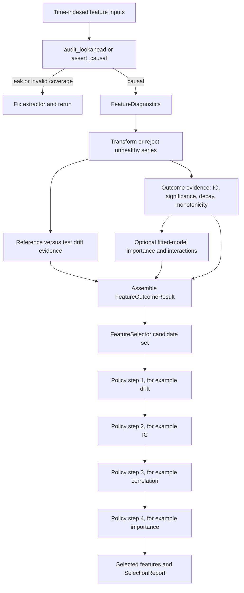

# Feature Diagnostics, Causality, and Selection

Feature evaluation has two deliberately separate layers:

1. **Statistical evidence** asks whether a feature is causal, statistically usable, predictive, stable, important to a fitted model, or involved in interactions.
2. **Selection policy** decides which candidates survive, in what order, and under which thresholds.

The distinction matters. A diagnostic result is evidence, not an automatic keep/drop decision. Conversely, `FeatureSelector` does not calculate IC, fit models, detect drift, or audit look-ahead; it consumes already-computed evidence and mutates a candidate set according to the caller's ordered policy.



*The flow separates evidence production from the sequential, caller-defined elimination policy.*

## 1. Establish temporal causality first

The model-class-agnostic gate is [`audit_lookahead`](../../src/ml4t/diagnostic/evaluation/causality.py). It treats causality as future-perturbation invariance: for each cutoff, it destroys non-key inputs after the cutoff with `nan`, `shuffle`, and `noise`, reruns the extractor, and compares feature outputs at or before the cutoff. If past outputs move beyond the measured threshold, the extractor used future information.

The expected extractor has type `Callable[[pl.DataFrame], pl.DataFrame]`. By default the keys are `("symbol", "timestamp")`; the last key is the time axis and earlier keys define entity groups. Keys must be non-null and unique. Output may either carry the keys or have exactly the same row count so the auditor can attach keys positionally. Derived output columns are audited by default; `feature_cols` makes the set explicit.

A useful CI gate is:

```python
from ml4t.diagnostic.evaluation.causality import assert_causal

report = assert_causal(
    extract=my_feature_extractor,
    frame=panel,
    keys=("symbol", "timestamp"),
    feature_cols=["momentum", "regime_probability"],
)
```

The engine runs the unmodified extractor twice to estimate per-feature nondeterminism. A perturbation is a leak only when its pre-cutoff delta exceeds `max(atol, noise_floor * noise_multiplier)`. Corruption RNGs are reproducible from `seed`. Ineffective probes are reported rather than silently counted; without an observed leak, every cutoff must have an effective corruption and every cutoff-feature pair must have a pre-cutoff comparison before a causal verdict is allowed.

`audit_lookahead` returns a `CausalityReport` with the verdict, determinism information, all `LeakEvent`s, worst leak per column, probe counts, skipped probes, and coverage gaps. It renders through `to_html()`, `to_markdown()`, and `to_json()`. `assert_causal` returns the same report on success and raises `CausalityError` on leakage, attaching the report for CI diagnostics.

This gate is intentionally incomplete: it cannot detect same-timestamp target leakage, and it does not prove that train/validation folds are sealed. Use leakage-safe splitting and purging separately; see [Validated Cross-Validation](validated-cross-validation.md).

## 2. Diagnose the feature as a time series

[`FeatureDiagnostics`](../../src/ml4t/diagnostic/evaluation/feature_diagnostics.py) orchestrates four configurable modules for one series or every requested DataFrame column:

- stationarity: enabled ADF, KPSS, and Phillips-Perron tests plus consensus;
- autocorrelation: ACF/PACF significant lags and white-noise assessment;
- volatility: ARCH-LM and optional GARCH fitting;
- distribution: moments, normality, tail analysis, and a recommended distribution.

`run_diagnostics()` accepts a one-dimensional pandas Series, Polars Series, or NumPy array. `run_batch_diagnostics()` accepts a pandas or Polars DataFrame and returns a mapping by feature name; requested missing columns are warned about and skipped. Construction fails if all four modules are disabled, while malformed, empty, or non-1D input raises `ValidationError`.

Each module is isolated behind a broad exception handler: one failed analysis is logged and represented as `None`, while the remaining modules continue. The result then derives a summary table, recommendations, warning flags, and a health score normalized over the modules that actually produced results. The four available modules contribute equal maximum weight, but their scoring rules differ: stationarity consensus, number of significant ACF lags, volatility clustering/GARCH convergence, and recommended distribution. If every enabled module fails, the result has score `0.0`, `ALL_MODULES_FAILED`, and an input-inspection recommendation. This is important operationally: a result object does not imply that evidence was successfully produced.

Treat `health_score`, flags, and recommendations as triage aids. They are not consumed by `FeatureSelector` and should not replace review of the underlying test results.

## 3. Measure outcome evidence

The principal outcome entry point is [`analyze_feature_outcome`](../../src/ml4t/diagnostic/metrics/feature_outcome.py). It joins predictions to forward returns computed from prices, then provides:

- a cross-sectional IC time series, using Spearman by default or Pearson when requested;
- IC mean, standard deviation, annualized IC-IR and confidence interval;
- HAC-adjusted significance by default, with a non-HAC summary fallback;
- optional IC decay across horizons and estimated half-life;
- optional quantile monotonicity;
- a human-readable interpretation and analysis metadata.

For panels, pass `group_col` so IC is computed across entities per date. Observation keys are validated before the inner join. The default decay horizons are `[1, 2, 5, 10, 21]`; horizon and signal half-life should be evaluated against the intended holding period rather than reduced to a universal IC threshold. The lighter `analyze_feature_outcome_series()` aligns one prediction series to one outcome series, removes NaN pairs, and offers optional monotonicity; it returns an explicit weak-evidence contract for fewer than three usable observations.

### Drift is separate evidence

[`analyze_drift`](../../src/ml4t/diagnostic/evaluation/drift/analysis.py) compares reference and test feature distributions. PSI and Wasserstein run per feature, while the optional domain classifier tests multivariate separation. Per-feature consensus is the fraction of successfully run univariate methods that detected drift; a feature is flagged when that fraction meets the configured consensus threshold. Individual method failures are allowed to continue, so inspect `n_methods_run` as well as `drift_probability`.

The selector's PSI policy is narrower than the drift analyzer's general alerting: `filter_by_drift(method="psi")` removes only features whose `psi_result.alert_level == "red"`; its `threshold` argument is not consulted in that branch. `method="consensus"` instead removes when `drift_probability >= threshold`.

## 4. Optional fitted-model evidence

Model-based evidence is useful only after fitting under a leakage-safe validation design.

[`analyze_ml_importance`](../../src/ml4t/diagnostic/metrics/importance_analysis.py) can compare MDI, permutation feature importance (PFI), MDA, and SHAP, then average ranks, assess pairwise rank agreement, and report methods that failed. Backend contracts differ:

- MDI requires a fitted model exposing `feature_importances_`;
- PFI and MDA require prediction/scoring behavior and labeled `X`, `y`;
- SHAP requires the optional `shap` dependency and a compatible explainer/model.

SHAP auto-selection tries tree, then linear, then model-agnostic kernel explainers. Deep explanation is explicit-only and requires background data plus the relevant deep-learning backend. Install the repository's ML extra for LightGBM, XGBoost, and supported SHAP builds:

```bash
pip install "ml4t-diagnostic[ml]"
```

[`analyze_interactions`](../../src/ml4t/diagnostic/metrics/interactions.py) compares three different notions of interaction: conditional IC (no model required), Friedman's H-statistic (requires `predict()` and repeated partial-dependence evaluation), and SHAP interaction values (requires SHAP and a tree model). Both H-statistic and SHAP paths subsample to bound cost. Method disagreement is itself evidence: these methods answer different questions and should not be collapsed into a causal claim.

## 5. Adapt evidence into the selector contract

`FeatureSelector` consumes [`FeatureOutcomeResult`](../../src/ml4t/diagnostic/selection/types.py), which contains a feature list, mappings of `FeatureICResults` and `FeatureImportanceResults`, and optional `DriftSummaryResult`. This is an integration DTO, not the direct return type of `analyze_feature_outcome()` or `analyze_ml_importance()`. The workflow owner must map those dictionaries/results into the per-feature dataclasses, including the desired lag convention and observation count, before selection.

That boundary is valuable: evidence generation can evolve independently of policy, but it also means there is no automatic guarantee that IC horizons, model validation windows, drift windows, and feature names are mutually aligned. Validate those semantics during assembly.

## 6. Apply an ordered selection policy

`FeatureSelector` begins with either `initial_features` or every feature in `FeatureOutcomeResult.features`. Its filters mutate `selected_features`, accumulate `removed_features`, append a `SelectionStep`, and return `self` for chaining. Removed features do not re-enter later steps unless `reset()` restores the initial state. Therefore **order changes the answer**.

`run_pipeline()` accepts a caller-ordered list of `(filter_name, parameters)` tuples and dispatches only `ic`, `importance`, `correlation`, and `drift`. There is no hard-coded canonical order. A defensible triage order is often drift → IC → correlation → importance: reject unstable inputs, require standalone outcome evidence, remove redundancy while good candidates remain, then use fitted-model evidence as a final discriminator. Change that order deliberately for the research question.

```python
selector = FeatureSelector(
    outcome_results=evidence,
    correlation_matrix=correlation_matrix,
)
selector.run_pipeline([
    ("drift", {"method": "consensus", "threshold": 0.5}),
    ("ic", {"threshold": 0.02, "min_periods": 20, "lag": 5}),
    ("correlation", {"threshold": 0.8, "keep_strategy": "higher_ic"}),
    ("importance", {"threshold": 0.01, "method": "permutation"}),
])
selected = selector.get_selected_features()
report = selector.get_selection_report()
```

The policies are precise:

| Filter | Keep/remove rule | Important edge behavior |
|---|---|---|
| `filter_by_ic` | Keep when absolute mean IC, or the requested lag IC, is at least `threshold`, with enough observations. | A missing requested lag or too few observations removes the feature. A feature absent from `ic_results` is left unchanged. |
| `filter_by_importance` | Keep scores at least `threshold`, or the top `top_k`, using `mdi`, `permutation`, or `shap`. | Features without usable importance—including SHAP with `shap_mean is None`—are not in the keep list and are removed. |
| `filter_by_correlation` | For pairs with absolute correlation above `threshold`, keep higher absolute mean IC, higher MDI, or the lexically first candidate. | Requires a correlation matrix. Candidates absent from its row-name set are not pair-compared and remain selected. Ties in score remove the earlier candidate under the current comparison logic. |
| `filter_by_drift` | Remove PSI-red features or features meeting the consensus probability threshold. | Requires `drift_results`; only currently selected features are considered. |

`SelectionReport` preserves the initial and final sorted feature lists plus each step's parameters, before/after counts, removals, survivors, and textual reasoning. It is an audit trail of policy execution, not proof that the upstream evidence was correctly estimated.

## Failure checks and test anchors

Focused tests establish the contracts most likely to protect this workflow:

- [`test_causality.py`](../../tests/test_evaluation/test_causality.py) exercises causal and leaking extractors, corruption coverage, key alignment, nondeterminism thresholds, and CI failure behavior.
- [`test_feature_diagnostics.py`](../../tests/test_evaluation/test_feature_diagnostics.py) covers configuration, batch input, summaries, partial/all module failures, scores, and flags.
- [`test_feature_outcome.py`](../../tests/test_evaluation/test_feature_outcome.py) covers pair alignment, NaN filtering, small samples, and optional monotonicity.
- [`test_systematic.py`](../../tests/test_selection/test_systematic.py) fixes filter thresholds, lag behavior, correlation strategies, drift policies, order, reporting, reset, and empty/all-pass outcomes.
- [`test_integration.py`](../../tests/test_selection/test_integration.py) exercises multi-step selection and report consistency.

For downstream interpretation of selected signals, continue with [Signal Analysis](signal-analysis.md). For factor and portfolio consequences rather than feature admission policy, see [Portfolio, Trade, and Factor Analysis](portfolio-trade-and-factor-analysis.md).
