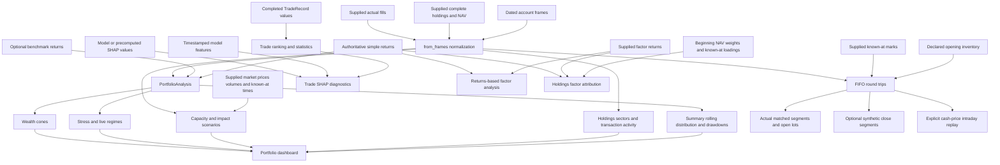

# Portfolio, Trade, and Factor Analysis

This domain has several related but deliberately separate analytical surfaces. Return observations support performance and risk analysis; complete account snapshots support exposure analysis; actual fills support transaction and FIFO analysis; supplied market bars support capacity; supplied factor returns or holdings loadings support two different kinds of factor attribution; and model features plus SHAP values support trade explanations. None of these surfaces is evidence for an absent one.

For the producer-to-report bridge, see [Backtest and Artifact Integration to Tearsheet](../integrations/backtest-to-tearsheet.md). Its provenance rules are especially important here: target weights are not fills, returns are not holdings, and a compounded equity curve is not an observed account ledger. Time, calendar, and result conventions are covered by [Contracts, Time, and Results](../concepts/contracts-time-and-results.md).

## Analysis map



*Each arrow represents a supplied input or an explicit derived result; the workflow does not reconstruct missing holdings, fills, marks, returns, or model explanations implicitly.*

## Choose the input boundary first

### Return-array boundary

`PortfolioAnalysis(returns=..., benchmark=..., dates=...)` is the lightweight path. Returns must be nonempty, finite, one-dimensional simple returns no lower than `-1`; missing observations are rejected rather than zero-filled. A dated benchmark is aligned to strategy keys without filling, while an undated benchmark must have the same length. Undated strategy data remains useful for observation-based metrics and rolling windows, but calendar tables and complete reports require real dates.

The constructor owns snapshots of inputs and returns copies of arrays and cached results. `periods_per_year` is the explicit annualization scale; it is not inferred from arbitrary observation spacing.

### Dated account-frame boundary

Use `PortfolioAnalysis.from_frames(...)` when provenance matters across returns, positions, valuations, and transactions:

```python
analysis = PortfolioAnalysis.from_frames(
    returns=returns_frame,
    benchmark=benchmark_frame,
    positions=positions_frame,
    valuations=account_frame,
    transactions=fills_frame,
    complete_snapshots=True,
    snapshot_kind="end_of_day",
    initial_nav=1_000_000,
)
```

`from_frames` normalizes and owns Arrow snapshots in `PortfolioInputData`. The normalized roles are strict:

- returns are authoritative **net simple returns**, never inferred from NAV;
- positions are signed reported cash values, in long or wide form;
- a wide `cash` column is reported account cash, not an asset and not evidence of NAV;
- valuations contain reported equity/cash only; unreported NAV remains unknown;
- transactions are actual records with signed quantity, price, positive multiplier, and stable asset IDs;
- absent commission or slippage is unknown (`null`), not zero;
- absent optional tables remain `None`, not observed empty ledgers.

`complete_snapshots=True` is a consequential declaration: absent assets within an observed snapshot may be treated as zero, and the normalizer checks snapshot coverage. It does not forward-fill a missing snapshot. `snapshot_kind` (`observed`, `end_of_day`, or `intraday`) records caller-declared provenance; it does not infer a schedule. Calendar metadata is retained for later session-aware operations but does not resample returns or certify schedule completeness during normalization.

## Portfolio returns, risk, and temporal analyses

`compute_summary_stats()` derives total and annual return, annual volatility, Sharpe, Sortino, Calmar, Omega, tail ratio, max drawdown, moments, VaR/CVaR, stability, win/loss summaries, and—when a benchmark exists—alpha, beta, information ratio, and up/down capture. Its profit factor is based on sums of positive and negative **period returns**; it is not completed-trade cash P&L.

Other return-driven entry points include:

- `compute_rolling_metrics(windows=..., metrics=...)` for observation-window Sharpe, volatility, compounded returns, and benchmark beta;
- `compute_drawdown_analysis(top_n=..., threshold=...)` for the underwater curve and distinct peak-to-recovery episodes, with the initial valuation treated as a high-water mark rather than an extra return;
- `compute_returns_distribution()`, `compute_monthly_returns()`, `compute_annual_returns()`, and `get_monthly_returns_matrix()`;
- `compute_stress(periods=...)` for named or custom windows, preserving unobserved windows as a coverage issue rather than a zero-return sample;
- `compute_live_split(live_start=...)` for the strict before versus at/after partition without inferring account rows;
- `compute_wealth_cones(...)` for IID or circular stationary-bootstrap wealth paths trained only on rows strictly before `live_start`.

Wealth-cone horizons are counts of observations, not calendar days or inferred future sessions. Actual live rows are only an overlay and cannot enter the training sample. When a benchmark exists, sampled strategy and benchmark rows remain paired. Stationary sampling requires an explicit expected block size in training observations.

## Holdings, transactions, and denominator discipline

### Holdings snapshots

`compute_holdings_analysis()` requires dates and supplied positions. It analyzes exact return-observation keys, signed market values, reported cash/NAV, concentration, leverage, and optional sector mappings. Missing marks fail; NAV is never inferred as cash plus holdings. Sector labels may be static or exact-date mappings; unknown labels remain an explicit null-sector group, and account cash remains separate from any asset sector named `cash`.

Observed holdings and inferred intraday exposure must not be conflated:

- `snapshot_kind="intraday"` identifies caller-supplied complete intraday snapshots.
- `compute_intraday_estimate(method="legacy_peak_notional", ...)` is explicitly a **daily transaction-notional estimate**, not observed intraday holdings.
- `RoundTripResult.reconstruct_intraday_exposure(...)` is a separate, explicit event replay from complete opening inventory, actual fills, supplied known-at marks, and a selected cash-price accounting model.

### Beginning NAV versus closing NAV

The native transaction path uses beginning-period capital. `compute_transaction_analysis()` accepts `turnover_denom="beginning_nav"` or `"average_gross_book"`; gross versus one-way turnover changes the notional convention. Regardless of that turnover choice:

- observed implementation-cost return is implementation cost divided by **beginning NAV**;
- incremental bps scenarios use actual gross traded notional and **beginning NAV**;
- supplied net returns remain authoritative, so observed fees are not subtracted a second time;
- missing or nonpositive NAV leaves normalized values undefined while raw notional and cash cost remain available.

Average gross book requires declared complete positions. The first average-gross-book denominator is undefined without a previous complete snapshot.

This differs from the separately named legacy Pyfolio capacity adapter, whose `apply_slippage_penalty(...)` divides retrospective impact by compounded **closing NAV**. Beginning- and closing-NAV results are therefore not interchangeable: they encode different capital timing and should be labeled when compared.

`TransactionAnalysisResult.execution_timing()` bins actual event-time counts, units, and cash notional across the complete civil day in an explicit or declared timezone. It does not impose US-equity hours, so overnight fills remain visible.

## Capacity is a supplied-market scenario

`compute_capacity(market_data, ...)` requires owned `from_frames` positions declared complete. It may reuse actual fills and authoritative returns, but market price, volume, multiplier, adjustment basis, currency, and availability come from the supplied market frame and `FeedSpec`.

The calculation uses lagged average dollar volume—`price * volume * multiplier`, shifted by one selected observation/session—to avoid using the decision bar's future liquidity as the liquidation denominator. A known zero-volume open position is unbounded; missing coverage is unavailable, not a free liquidation. Book duration assumes assets liquidate in parallel with an independent participation budget per asset.

Transaction participation is retrospective same-bar absolute units divided by volume. Capital scenarios apply a declared quadratic volume-share coefficient to closing-mark notional; they are hypothetical extra-impact sweeps, not empirically fitted impact models or executable orders. Native scenarios subtract those extra costs once using supplied returns and beginning-period NAV. The function performs neither FX conversion nor corporate-action adjustment, so `currency`, `price_basis`, and `volume_basis` must declare compatible units.

## FIFO round trips and intraday replay

`compute_round_trips(...)` operates only on supplied executions and requires an explicit complete opening state:

- `initial_state="flat"` declares no opening inventory;
- `initial_state="supplied"` requires `opening_lots` and `opening_as_of`;
- marks and `synthetic_close=True` require an explicit `as_of` cutoff.

The native `actual_fifo` matcher retains fractional units with exact rational arithmetic, closes old lots before opening reversal remainder, allocates commission once, and preserves unknown basis, time, or fees as unknown. Same-instant fills retain supplied row order; no exchange priority is inferred. `matching="consecutive_vwap"` is an explicit analytical grouping profile, not a reconstruction of exchange execution state.

**Actual and synthetic closes stay distinct.** Actual matched segments arise from closing fills and change open inventory. A synthetic close uses a supplied mark known at or before `as_of` to create a separate hypothetical segment; it is opt-in for completed-trade summaries, statistics, and trade conversion and does not alter actual realization, remaining inventory, or the supplied return series.

`RoundTripResult` can then produce:

- `completed_trades()` with cash P&L and lot return based on absolute entry notional;
- `to_trade_analysis()` for the common trade-statistics interface;
- `portfolio_contributions()` and `statistics_tables(return_basis="nav", ...)`, which require a supplied **beginning-period NAV** denominator rather than substituting lot return;
- `profit_attribution()` by asset and optional sector;
- `reconstruct_intraday_exposure(...)` for explicit full-notional cash-price replay.

The intraday replay requires opening and terminal instants and a known-at supplied mark for every held asset. It samples opening, each actual fill, relevant mark-only events, and the terminal point. Its peak is the maximum over those event observations, not an unobserved continuous-time maximum; averages are event-weighted, not elapsed-time weighted. Fill prices are not silently substituted for marks. Unknown opening cash or any unknown commission makes subsequent cash/NAV unknown, and the replay explicitly does not model futures margin, FX, dividends, deposits, or corporate actions.

## Completed-trade diagnostics

`TradeAnalysis` consumes completed `TradeRecord` or `TradeMetrics` values—not raw intended orders. It can filter by symbol, minimum known duration, P&L range, and exit-date range, then ranks worst/best trades by realized cash P&L and computes aggregate counts, win rate, P&L distribution, profit factor, extrema, and duration summaries. Empty input or a filter that removes every trade raises instead of returning a misleading empty report.

`TradeMetrics.return_pct` depends on its declared basis. Native price return uses absolute entry price and direction; FIFO-converted analysis can declare `return_basis="entry_notional"` and divide P&L by matched absolute entry notional. A zero denominator remains undefined. Unknown duration remains unknown and does not become zero days.

`TradeAnalysis.analyze()` packages worst trades, best trades, statistics, and total analyzed count in a serializable `TradeAnalysisResult` with Polars views. This is the bridge from portfolio round trips or producer `TradeRecord` values to model diagnostics.

## SHAP explanations are optional model diagnostics

`TradeShapAnalyzer` needs a trained model, a pandas or Polars feature frame containing `timestamp`, and either precomputed SHAP values or enough model support to compute them lazily. A provided SHAP matrix must have exactly one row per feature observation and one column per non-timestamp feature.

The analyzer aligns trades to timestamped feature/SHAP rows, explains individual or worst trades, extracts normalized SHAP vectors, clusters recurring error patterns, characterizes distinguishing features, and generates hypotheses/actions. Clustering needs at least three trades and also honors the configurable `min_trades_for_clustering` threshold.

SHAP and model backends are optional dependencies. The `ml` extra supplies LightGBM, XGBoost, and SHAP where the platform marker permits it:

```bash
pip install 'ml4t-diagnostic[ml]'
```

Precomputed SHAP values avoid on-demand explainer construction, but they do not remove the need for exact feature names, row alignment, and timestamps. The integration test exercises the complete trade-ranking → explanation → vector normalization → clustering path with precomputed values; it skips when LightGBM is unavailable. Treat generated hypotheses as diagnostic prompts, not causal proof. Feature diagnostics upstream are described in [Feature Diagnostics and Selection](feature-diagnostics-and-selection.md).

## Two factor-attribution models

### Returns-based estimated exposures

`FactorAnalysis(returns, factor_data, periods_per_year=...)` orchestrates a static OLS factor model, rolling exposures, return attribution, maximal attribution, covariance-based risk decomposition, model validation, timing diagnostics, and optional Kalman betas. Parameterized results are cached. `generate_report()` builds factor-beta, rolling-beta, return-attribution, risk, residual, and factor-correlation Plotly figures.

This path **estimates** betas from portfolio and factor returns. Return attribution uses lagged rolling exposures; risk attribution reuses the static model. It should not be described as holdings-level attribution.

### Supplied holdings exposures

`PortfolioAnalysis.compute_holdings_attribution(...)` instead consumes supplied beginning-period NAV weights, factor returns, and asset factor loadings. It does not fit betas. The native path requires:

- complete snapshots explicitly declared;
- an interval start for each return, supplied directly or derived from a real `initial_timestamp` plus preceding return timestamps;
- `known_at` instants for weights and loadings no later than the corresponding interval start;
- factor loadings for every nonzero asset/factor weight.

End-period holdings are not silently reinterpreted as beginning weights. Missing loading coverage raises by default; the named legacy skip mode retains uncovered gross weight in coverage instead of claiming zero exposure. Per-factor contribution is exposure times factor return; specific return is the supplied total less common factor contribution and, when separately supplied, cash contribution. Wealth-linked cumulative attribution multiplies each period's additive contribution by prior realized wealth; arithmetic accumulation is an explicit alternative.

## Dashboard assembly and lifecycle

`create_tear_sheet(...)` delegates to the portfolio dashboard. Core return panels are computed from the analysis. Complete holdings may be computed automatically only when `from_frames` positions exist and `complete_snapshots=True`. Transaction, capacity, intraday, stress, live, and wealth-cone panels must be explicitly prepared and passed in; the renderer does not choose financial methods or reconstruct missing inputs on the caller's behalf.

A safe lifecycle is:

1. Select the array or frame boundary and declare time/calendar semantics.
2. Validate and snapshot authoritative inputs.
3. Compute only analyses whose required surfaces are genuinely present.
4. Keep denomination, timing, coverage, and observed/estimated/synthetic provenance attached to results.
5. Pass prepared optional analyses to the dashboard.
6. Serialize owned result tables where supported, or publish the dashboard after all validation succeeds.

## Failure semantics and safe extensions

Expect deliberate failures for missing dates on calendar outputs, mismatched benchmark keys, absent fills for transaction/FIFO analysis, incomplete holdings for capacity, missing marks during explicit intraday replay, invalid/nonpositive denominators, timezone ambiguity, unavailable factor loadings, SHAP shape mismatch, and insufficient clustering samples. These failures protect the meaning of the result.

When extending the workflow:

- add a new input role to normalization rather than deriving it from a nearby surface;
- keep actual, estimated, and synthetic rows in separate fields or tables;
- name the capital timing in every normalized metric, especially beginning versus closing NAV;
- preserve unknown costs, basis, marks, and NAV as null with coverage metadata;
- require known-at information for causal holdings/loadings or market data;
- add dashboard panels that consume already prepared result objects rather than silently selecting analytical conventions.

## Focused verification

The most useful tests establish contracts rather than merely checking numerical smoke output:

- `tests/test_evaluation/test_portfolio_analysis.py` covers summary and benchmark metrics, rolling behavior, drawdown episode boundaries, caching, undated observation indices, and owned input properties.
- `tests/test_evaluation/test_portfolio_fifo.py` proves explicit opening-state requirements, fractional FIFO, reversal ordering, one-time fee allocation, unknown net P&L, same-instant ordering, multipliers, zero basis, and overflow failures.
- `tests/test_evaluation/test_factor_attribution.py` checks contribution identities, lag sensitivity, confidence intervals, NaN alignment, maximal attribution, and result conversion.
- `tests/test_integration/test_full_workflow.py` validates the end-to-end completed-trade, worst-trade, precomputed-SHAP, explanation, normalization, and clustering workflow with optional LightGBM.

The principal implementation entry points are [`portfolio_analysis/analysis.py`](../../src/ml4t/diagnostic/evaluation/portfolio_analysis/analysis.py), [`portfolio_analysis/frame_inputs.py`](../../src/ml4t/diagnostic/evaluation/portfolio_analysis/frame_inputs.py), [`portfolio_analysis/fifo.py`](../../src/ml4t/diagnostic/evaluation/portfolio_analysis/fifo.py), [`trade_analysis.py`](../../src/ml4t/diagnostic/evaluation/trade_analysis.py), [`trade_shap_diagnostics.py`](../../src/ml4t/diagnostic/evaluation/trade_shap_diagnostics.py), and [`factor/analysis.py`](../../src/ml4t/diagnostic/evaluation/factor/analysis.py).
