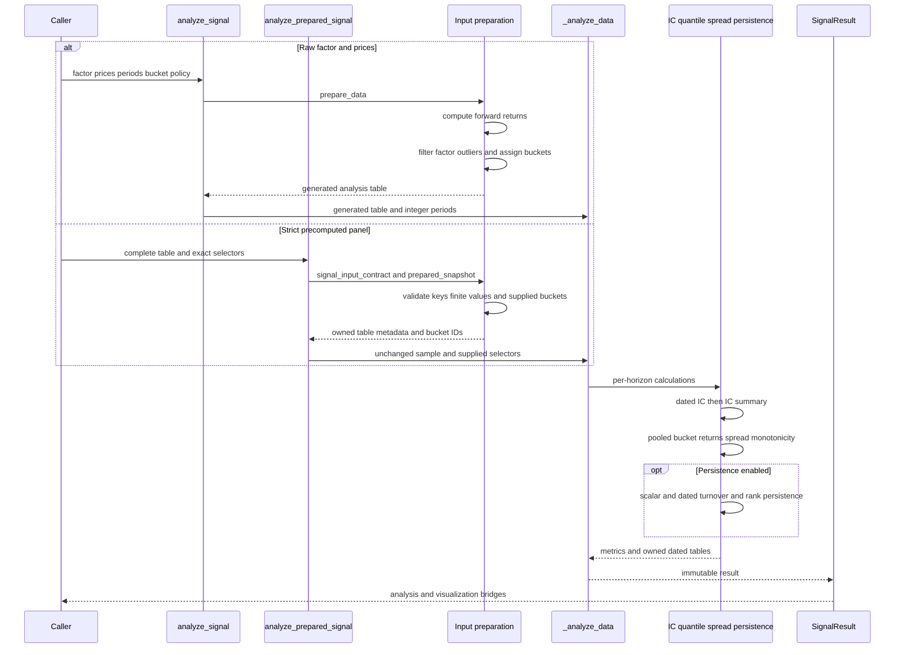

# Signal Analysis Workflow

The signal package has two deliberately different ingestion contracts and one shared scalar analysis engine. `analyze_signal` is the convenient legacy path: it joins factors to prices, constructs forward returns, optionally filters outliers, and assigns buckets. `analyze_prepared_signal` is the preservation path: it validates a complete table, keeps the supplied outcome columns and bucket IDs, and refuses to clean or reinterpret it. For audited research, `prepare_signal_panel` is the richer front door: it creates an owned, common finite sample with staged loss provenance and then delegates analysis to the strict prepared path.

This workflow sits beside the broader [time and result contracts](../concepts/contracts-time-and-results.md), and its legacy adapters are discussed in [Legacy Compatibility](../integrations/legacy-compatibility.md).

## Entry points and input policy

### Raw factors plus prices: `analyze_signal`

```python
from ml4t.diagnostic import analyze_signal

result = analyze_signal(
    factor=factor_df,
    prices=prices_df,
    periods=(1, 5, 21),
    quantiles=5,
)
```

`prepare_data` converts Pandas or Polars inputs, computes `{period}D_fwd_return`, applies the optional per-date factor outlier filter, and then assigns quantiles. The default `quantile` method is the legacy rank method; `qcut` uses Pandas-compatible equal-frequency edges, while `uniform` is the legacy equal-width method. This path computes outcomes and bucket membership, so it is not appropriate when those artifacts must remain exactly as supplied. It also does not attach an owned prepared-data snapshot to the result.

### Already complete panels: `analyze_prepared_signal`

A prepared table must have unique date/entity keys, a finite factor, positive integer `quantile` values, and finite values in every selected return column. The validator accepts ordinary Pandas MultiIndex/Alphalens names such as `factor_quantile` and `1D`, but canonicalizes them without rebucketing. Duplicate keys, missing/nonfinite selected values, ambiguous representations, and invalid bucket labels fail before calculations.

Use either:

- `periods=(1, 5, 21)`, which selects `{period}D_fwd_return` or legacy `{period}D` columns and defaults to five contiguous buckets; or
- `return_columns=(...)`, which treats names as exact selectors and preserves actual positive bucket IDs, including sparse IDs.

The two selector forms are mutually exclusive. Arbitrary supplied labels are **not** durations: they establish no session calendar, expected-bar grid, endpoint, or annualization. Automatic turnover recognizes only exact positive-day labels such as `5D`, and even then the integer is an offset in observed factor timestamps rather than elapsed days.



*The two public entry points diverge in whether they manufacture or preserve outcomes and buckets, then converge in `_analyze_data`.*

## Audited panel preparation

`prepare_signal_panel` is separate from the simple `prepare_data` helper. It accepts exactly one outcome source:

1. **Supplied wide outcomes** in `forward_returns`, optionally selecting `return_columns`.
2. **Supplied long outcomes** identified by `horizon_col` and `return_col`; these are normalized once to wide analytical columns while the original endpoint and availability records remain in `outcome_data`.
3. **Prices**, with an explicit `price_basis` and named observation-count `horizons`.

The cleaner starts with the original factor-row count and records disjoint losses in order: nonfinite factor, missing/nonfinite requested outcomes, missing/nonfinite groups, and bucketing. Only requested outcomes determine the common sample; unused columns do not remove rows. `excluded_data` preserves each excluded key with its first stage and reason. The total loss fraction uses the original factor count, equality with `max_loss` passes, and excess loss raises `MaxLossExceededError`. Bucket failures may become audited bucket losses when `max_loss > 0`; with `max_loss=0`, their underlying error is exposed immediately.

Bucketing occurs only after the common finite sample is selected. `quantiles` and `bins` are mutually exclusive, support explicit edges, and can be `zero_aware`. `binning_by_group=True` changes the bucket-assignment partition to date/group, but does not by itself make later ICs, outcomes, or factor portfolios group neutral.

The returned frozen `PreparedSignalPanel` owns Arrow IPC snapshots of retained data, exclusions, optional long outcomes, and JSON audit metadata. Accessors decode fresh frames, so mutating either a caller input or a returned frame does not mutate the panel. `PreparedSignalPanel.from_prepared` is the no-cleaning equivalent for a panel that is already complete.

### Price-derived outcomes are research views

The prices route requires a declared `price_basis`; it never guesses or applies an adjustment. `common_grid` shifts over the union quote clock, whereas `per_asset` shifts over each asset's observed rows. `cumulative` uses entry-to-exit returns and `exit_bar` uses only the terminal interval. Optional forward fill builds an analytical price view while retaining original row and quote-presence flags.

The long outcome snapshot records reference and exit keys, observed/present flags, outcome status, and availability when it can be established. Analytical fills and lookahead-sensitive return filtering leave availability unknown. Observation shifts are not validated as sessions or expected bars, and filled values do not become observed or executable quotes.

## Shared calculations and statistical meanings

For every selected outcome, `_analyze_data` computes:

- a per-date Pearson or Spearman IC series using finite factor/outcome pairs and `min_assets`, followed by mean, sample deviation, t-statistic, p-value, positive percentage, and IC information ratio;
- pooled mean and standard deviation for each supplied bucket;
- top-minus-bottom spread using the native pooled two-sample inference;
- monotonicity as rank correlation across pooled bucket means; and
- optional persistence metrics.

These definitions must not be silently mixed with the panel's inspectable dated statistics:

- `result.quantile_returns` and the default `analyze()` spread are **pooled asset-date** summaries.
- `panel.quantile_statistics(by_date=True)` emits per-date bucket means, asset counts, sample deviations, and errors.
- `panel.quantile_statistics(by_date=False)` first forms daily means and then reduces them with **equal date weight**; its `n_obs` therefore counts dates, not pooled asset-date rows.
- `panel.quantile_spread(...)` subtracts arbitrary bucket means and may propagate leg errors independently. Its raw `+1/-1` difference has gross exposure two; it is not the pooled Student test and not a unit-gross portfolio return.

Likewise, `analyze_signal_information(panel, ...)` owns the dated IC sample, summary inference, civil-month means, and optional group-by-date views. `group_adjust=True` demeans outcomes within date/group before correlation. `by_group=True` adds group ICs without replacing the global sample. An explicit date grid retains missing requested dates as undefined IC observations; it does not invent factor rows.

### Persistence

When enabled, the shared engine retains both old scalar summaries and inspectable dated tables:

- scalar `compute_turnover` uses its larger-membership denominator;
- dated quantile turnover records entrants/current-membership fractions and counts;
- scalar autocorrelation averages paired-sample Spearman correlations;
- dated rank autocorrelation ranks complete scored dates before Pearson pairing; and
- half-life is estimated from the scalar autocorrelation sequence.

Consequently, scalar and dated persistence views are related but not interchangeable. No missing dated series can be reconstructed from a scalar mean. On prepared arbitrary labels, automatic quantile turnover is produced only for exact `nD` selectors; rank autocorrelation still uses the configured observed-row lags.

## Return, event, and portfolio views

The panel is the extension boundary for more explicit analyses:

- `ic_by_date` and `demean_returns` expose the shared finite-pair adjustment and status-bearing observations.
- `factor_weights` and `factor_returns` provide magnitude or equal-sign research weights and supplied-horizon contributions. Weights are formed independently of horizon-specific future missingness; zero signal yields zero exposure.
- `factor_alpha_beta` performs same-universe dated OLS and requires explicit annualization factors for compounded alpha.
- `event_study` and `event_returns` align supplied levels or compounded returns on an observed event clock. They retain actual paths, missing cells, event IDs, counts, and optional groups; they do not substitute a CAR or abnormal-return model.
- `factor_cumulative_returns` compounds mathematical observation-order returns. It does not establish daily self-financing P&L.

`analyze_signal_returns` composes owned weights, factor returns, regression tables, dated/equal-date quantile statistics, optional group statistics, spread observations, and wealth paths. Raw return statistics remain in the result even when `rate_conversion_factors` add display means and scale display errors. Display conversion is descriptive: it does not replace the raw values used for compounding, and the scaled errors are not confidence intervals. Missing values may produce flat mathematical wealth under the existing NaN-aware product, but remain missing observations rather than asserted zero returns.

### Research allocations are not execution holdings

`panel.positions(...)` requires explicit expiry keys, either from owned long price outcomes or a caller-supplied expiry table. `SyntheticPositionsResult` aggregates overlapping allocations on the union of entry and expiry events and distinguishes no active allocations, zero signals, offsetting allocations, and invested exposure. Its allocations are mathematical weights—not orders, fills, shares, or proof that the requested endpoint was executable.

`panel.to_portfolio_inputs(...)` resamples this research representation into owned daily returns, positions, valuations, and optional benchmark data. Its return path still compounds supplied forward outcomes rather than marked account P&L. `to_pyfolio()` emits familiar shapes and a research-origin marker, but creates no transactions and does not relabel the data as execution history.

## Result ownership, persistence, and visualization

`SignalResult` is a frozen dataclass containing scalar dictionaries, IC dates/series, exact horizon labels and bucket IDs, and optional Arrow snapshots for prepared data, long outcomes, dated turnover, dated autocorrelation, and dated quantile observations. Every frame property decodes a fresh copy.

`to_json` encodes owned frames as base64 Arrow IPC, changes non-finite metric values to JSON `null`, and can write a file. `from_json` validates each Arrow payload, rejects private frame fields and unsupported formats, restores tuple and integer bucket keys, and requires dated turnover and autocorrelation to be present together. This preserves nanosecond timestamps and typed keys rather than flattening them into lossy JSON records.

Visualization bridges are intentionally bounded:

- `to_ic_result(period=...)` preserves one horizon's dated IC sample; without a selector it aligns horizons to their common date intersection and recomputes summaries on that intersection.
- `to_quantile_result()` carries exact bucket IDs, horizon labels, pooled metrics, and dated quantile observations when available.
- `to_turnover_result()` returns `None` unless both real dated persistence tables exist; it never synthesizes observations from scalar means.
- `to_tear_sheet()` bundles only available IC, quantile, and persistence components. It does not imply cumulative paths or complete legacy sheet coverage.

## Invariants and common failure modes

- Supply prices or forward outcomes to `prepare_signal_panel`, never both or neither.
- Treat supplied outcome labels as selectors unless a separate contract explicitly supplies scales or endpoints.
- Keep date/entity/factor/group/quantile/exclusion column roles distinct and observation keys unique.
- Prepared analysis is fail-fast: it does not drop bad rows, fill outcomes, or repair buckets.
- Cleaning is complete-case across the **requested** outcomes before bucketing, so adding a requested sparse horizon can change every bucket's sample.
- A one-bucket analysis can still report its bucket return and IC, but long-short spread statistics remain unavailable rather than fabricated.
- Group-relative bucketing, group-adjusted outcomes, grouped reporting, and group-normalized portfolio weights are separate choices.
- Date grids may expose absent output cells but may not remove observed dates from a complete returns report.

## Focused verification

The most useful regression suites are:

```bash
pytest tests/test_signal/test_signal_api.py
pytest tests/test_signal/test_prepared_signal.py
pytest tests/test_signal/test_panel_cleaning.py
pytest tests/test_signal/test_signal_integration.py
```

`test_prepared_signal.py` verifies that supplied rows and buckets reach shared calculations unchanged, invalid panels fail before output mutation, and Arrow/JSON ownership preserves nanosecond keys. `test_panel_cleaning.py` covers staged losses, exact `max_loss` boundaries, requested-column common samples, bucket failures, group gaps, Float64 computation, and exclusion audit persistence. `test_signal_api.py` guards the public raw-price API, optional persistence, frozen results, and JSON restoration. `test_signal_integration.py` checks predictive, anti-predictive, and random-factor behavior, determinism, round trips, and larger samples.
