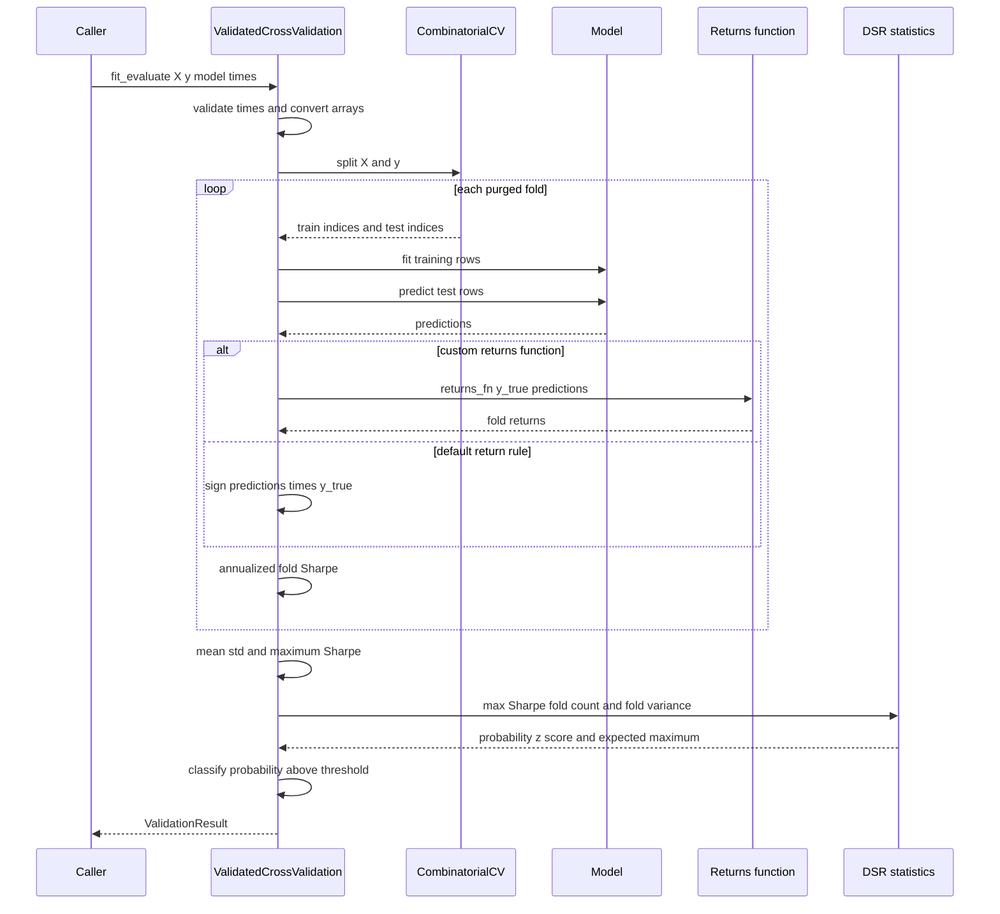

# Leakage-Aware Cross-Validation and Statistical Validation

Financial cross-validation has two separate responsibilities: construct train/test sets that do not leak future information, then decide whether the performance observed across those sets survives selection bias. The splitters solve the first problem. `ValidatedCrossValidation` is a narrower orchestration layer that uses `CombinatorialCV`, fits a model per fold, computes fold Sharpe ratios, and feeds the best observed Sharpe and the cross-fold variance into Deflated Sharpe Ratio (DSR).

This distinction matters. A calendar can define complete trading sessions for a `WalkForwardCV` window, while an integer label horizon still means observations. Conversely, giving `ValidatedCrossValidation.fit_evaluate()` a timestamp vector validates chronological row order but **does not** turn CPCV's integer windows into days or sessions.

For the library's broader time and result conventions, see [Contracts, Time, and Results](../concepts/contracts-time-and-results.md). For repository testing conventions, see [Development and Test Strategy](../testing/development-and-test-strategy.md).

## Choose the validation geometry first

### `WalkForwardCV`: deployment-like chronology

`WalkForwardCV` yields sequential folds in which training precedes validation. Its main choices are:

- **Expanding versus rolling:** `expanding=True` starts every training set at the beginning; `expanding=False` uses `train_size` when supplied.
- **Consecutive versus spread validation:** `consecutive=True` places test windows back-to-back. Otherwise, split points are spread over the available history to sample regimes.
- **Gap and purge:** `gap` moves the raw end of training back before purging. `label_horizon` then removes training observations whose forward labels overlap validation.
- **Held-out final test:** `test_period`, or `test_start` and `test_end`, reserves `test_indices_`. `fold_direction="backward"` constructs validation windows backward from that boundary but yields the successfully constructed folds in chronological order; `"forward"` steps toward the boundary without crossing it.
- **Group isolation:** if `isolate_groups=True` and `groups` is passed, any group represented in validation is removed from training. This is stronger than temporal purging and is useful when the intended test is generalization to unseen assets.

With ordinary row splitting, `test_size` and `train_size` can be integer row counts, floating proportions, or time strings when timestamps are available. The default test size is `n_samples // (n_splits + 1)`. A final implicit test fold can consume the remaining rows. Insufficient data for requested consecutive windows raises `ValueError`; held-out construction may produce fewer than `n_splits` when there is no room for both train and validation.

### `CombinatorialCV`: multiple backtest paths

`CombinatorialCV` partitions the timeline into `n_groups` contiguous groups and selects every combination of `n_test_groups` for testing. The nominal fold count is:

```text
C(n_groups, n_test_groups)
```

`max_combinations` caps that count. When capped, combination sampling is controlled by `random_state`; otherwise all combinations are generated. Each split starts with selected test groups and all remaining groups as candidate training data, then applies purging, embargo, and optional group isolation. Returned indices are sorted and deterministic for a fixed configuration and seed.

CPCV raises rather than yielding an invalid fold when purging leaves no training rows or when train and test overlap. It also rejects fewer rows than groups, inconsistent `X`/`y`/`groups` lengths, `n_test_groups` that is not smaller than `n_groups`, and simultaneous absolute and percentage embargo specifications.

When `align_to_sessions=True`, CPCV partitions complete values from `session_col` and retains exact row-index arrays. This avoids treating interleaved rows as a single positional range. It changes **group boundaries**, not the units of `label_horizon` or `embargo_size`.

## Purging, embargo, and assets

Purging and embargo protect different boundaries:

- **Purging before a test segment** removes candidate training observations whose forward-looking label interval reaches into the test interval. For an integer `label_horizon=5`, the five prior observations are at risk.
- **Embargo after a test segment** removes candidate training observations immediately after it, protecting against serial dependence. `embargo_size` is an absolute window; `embargo_pct` derives a row count from the relevant sample population.
- In standard walk-forward geometry, training is earlier than test, so a post-test embargo normally has no candidate training rows to remove. It matters directly in CPCV because a training group may follow a test group.

For multi-asset CPCV, passing `groups` makes purging operate in each asset's local observation sequence. Non-contiguous test groups are reduced to contiguous test segments per asset; assets with no test segment retain their candidate training rows. This prevents an integer five-observation horizon for one asset from being counted across rows belonging to another asset. The default `isolate_groups=True` additionally removes an entire asset from training if that asset appears in test. Set it to `False` when the intended design is temporal validation within each asset and rely on per-asset purging instead.

## Units: rows, elapsed time, and sessions

The controls are deliberately not interchangeable:

| Control | Unit and behavior |
|---|---|
| integer `test_size`, `train_size`, `gap`, `label_horizon`, `embargo_size` in a row path | Observations/row positions |
| floating `test_size` or `train_size` | Proportion of the applicable rows or sessions |
| `embargo_pct` | Fraction converted to an observation count, not elapsed time |
| `pd.Timedelta` horizon or embargo | Elapsed timestamp duration; requires extractable timestamps |
| string walk-forward size such as `"4W"` with a calendar | Converted to trading-session counts |
| `align_to_sessions=True` | Keeps group/fold boundaries on complete values of `session_col`; integer sizes are session counts in the walk-forward session path |
| `TradingCalendar` | Assigns timestamps to exchange sessions, handles timezone localization/conversion, and can filter non-trading rows in calendar-first walk-forward splitting |

`WalkForwardCV` takes the calendar-first path when a calendar is active and a time-string size is used, or when calendar filtering is enabled. Fold arithmetic then occurs in session space, complete session row sets are mapped back to row indices, and purging uses actual timestamp bounds. Explicit `calendar=None` disables this behavior. Calendar resolution otherwise follows explicit argument, declared config, feed metadata, then the default calendar policy.

`CombinatorialCV` is different: resolving a calendar does not convert its observation-count integer windows or elapsed `Timedelta` windows into sessions and does not by itself filter rows. `align_to_sessions` only controls partition boundaries. For elapsed-time CPCV purging, call `CombinatorialCV` directly with `pd.Timedelta` controls and timestamp-bearing input.

Most importantly, `ValidatedCrossValidation.fit_evaluate(..., times=...)` merely checks that `times` has the same length as `X`, is datetime-like, has no missing values, and is sorted non-decreasingly. It still calls `self._cv.split(X_np, y_np)` without timestamps or groups. Its configuration exposes only integer `label_horizon` and percentage embargo, so those controls remain sample-based whether or not `times` is supplied.

## The validated CPCV-to-DSR pipeline

`ValidatedCrossValidation` accepts any model implementing `fit(X, y)` and `predict(X)`. Pandas-like arrays and Polars feature/target objects are converted to NumPy before splitting. The same model object is refit for every fold.



*The sequence shows the implemented path from sample-based CPCV folds through model fitting, fold returns and Sharpes, DSR, and strict significance classification.*

For each fold, the default return rule is `np.sign(predictions) * y_test`. A custom `returns_fn(y_true, y_pred)` replaces that rule. Sharpe is the return mean divided by sample standard deviation (`ddof=1`), multiplied by `sqrt(annualization_factor)`; fewer than two returns or zero population standard deviation produces `0.0`.

The final aggregation is specific and should not be confused with a DSR over raw return series:

1. Compute mean and sample standard deviation of fold Sharpes.
2. Treat the **maximum fold Sharpe** as the selected observed Sharpe.
3. Treat the number of folds as `n_trials` and squared fold-Sharpe standard deviation as `variance_trials`.
4. Call `deflated_sharpe_ratio_from_statistics` with fixed `n_samples=252`, zero skewness, and zero excess kurtosis.
5. Classify as significant only when `dsr_result.probability > significance_level` (equality is not significant).

The resulting `ValidationResult` contains every `ValidationFoldResult`, fold count, mean and standard deviation, DSR probability and z-score, expected maximum Sharpe under the null, significance flag and threshold, and generated interpretation strings. `summary()` formats these fields; `to_dict()` exports aggregate fields and fold Sharpes, but not full predictions or return arrays. `evaluate_sharpes()` runs the same aggregation on precomputed Sharpes and uses placeholder fold records with empty returns and zero sizes. An empty list returns a non-significant default result with `"No folds completed"`.

### Current orchestration boundaries

The convenience layer is intentionally narrower than the underlying APIs:

- `fit_evaluate()` does not accept asset `groups`, timestamp columns, session alignment, absolute embargo, or `Timedelta` windows. Build folds with `CombinatorialCV` directly for those needs, then use `evaluate_sharpes()` if its aggregation assumptions are appropriate.
- Although the constructor accepts `StatisticalConfig`, the current DSR call uses fixed statistical arguments. Likewise, `ValidatedCrossValidationConfig.sharpe_star` and `random_state` are not forwarded into the implemented CPCV/DSR path. Do not assume changing them changes results.
- Fold count is used as DSR trial count. That is an orchestration policy, not an estimate of independent strategies; CPCV folds share data. For a strategy-search cohort or correlated trials, call the lower-level DSR APIs with the trial semantics required by the experiment.
- Model, prediction, and custom-return exceptions are not caught. A failed fold aborts the call rather than returning a partial `ValidationResult`.
- The interpretation text is heuristic. In particular, “potential overfitting” is emitted when selected Sharpe exceeds the null expected maximum; the authoritative significance field is the strict DSR probability comparison.

`validated_cross_val_score()` is only a shorthand for constructing `ValidatedCrossValidationConfig(n_groups=..., embargo_pct=...)` and calling `fit_evaluate()`; it does not open additional splitter controls.

## Reproducible folds

Fold persistence separates “which rows were evaluated” from later model runs:

```python
folds = list(cv.split(X, y, groups=groups))
save_folds(folds, X, "cv_folds.json", metadata={"splitter": "CPCV"})
loaded_folds, metadata = load_folds("cv_folds.json")
stats = verify_folds(loaded_folds, n_samples=len(X))
```

`save_folds()` writes version `1.0` JSON containing row count, train/test indices and sizes, fold count, and caller metadata. It optionally includes all timestamps plus per-fold first/last timestamp labels when a pandas `DatetimeIndex` or first Polars datetime column is available. These timestamp fields improve auditability; replay still uses the stored integer indices. Parent directories are created automatically.

`load_folds()` rejects missing files and versions other than `1.0`, reconstructs NumPy index arrays, and returns only folds plus metadata. `verify_folds()` checks in-fold train/test overlap and out-of-range indices and reports coverage and size statistics. It does **not** prove chronology, purge correctness, correspondence to the current dataset, or that saved timestamp values still match current rows. Persist the splitter config and a dataset identity/fingerprint in metadata when reproducibility requires those guarantees. `save_config()` and `load_config()` delegate to the config object's JSON serialization.

## Operational checklist

1. Decide whether the scientific question is chronological deployment (`WalkForwardCV`) or robustness across combinatorial paths (`CombinatorialCV`).
2. State every window's unit explicitly: rows, elapsed `Timedelta`, or trading sessions.
3. Sort timestamped data and preserve asset identity alongside any row reorder.
4. Set `label_horizon` to the target's true forward information span; add embargo only for the dependence being guarded against.
5. For multi-asset CPCV, choose deliberately between per-asset temporal purging (`isolate_groups=False`) and unseen-asset isolation (`True`).
6. Materialize, verify, and persist folds before expensive model fitting; store config and data identity too.
7. Confirm that the default return rule and annualization factor match the strategy. Supply `returns_fn` otherwise.
8. Treat DSR assumptions—selected maximum, fold count as trials, 252 samples, normal higher moments—as part of the reported methodology. Use the lower-level statistical API when they do not fit.
9. Read `is_significant` as a strict probability-threshold decision, not as proof that every fold is profitable or that leakage controls were correctly configured.

## Source and test landmarks

- [`WalkForwardCV`](../../src/ml4t/diagnostic/splitters/walk_forward.py) owns sequential, held-out, session, and calendar-first fold construction.
- [`CombinatorialCV`](../../src/ml4t/diagnostic/splitters/combinatorial.py) owns CPCV partition and combination orchestration; its purge engine is in [`cpcv/purge_engine.py`](../../src/ml4t/diagnostic/splitters/cpcv/purge_engine.py).
- [`TradingCalendar`](../../src/ml4t/diagnostic/splitters/calendar.py) owns timezone-aware exchange-session mapping.
- [Fold persistence](../../src/ml4t/diagnostic/splitters/persistence.py) defines the JSON replay format and integrity checks.
- [`ValidatedCrossValidation`](../../src/ml4t/diagnostic/evaluation/validated_cv.py) implements CPCV-to-Sharpe-to-DSR orchestration.
- Focused behavior is exercised by [validated CV tests](../../tests/test_evaluation/test_validated_cv.py), [CPCV tests](../../tests/test_splitters/test_combinatorial.py), [multi-asset purge tests](../../tests/test_splitters/test_multi_asset_purging.py), and [persistence tests](../../tests/test_splitters/test_persistence.py).
